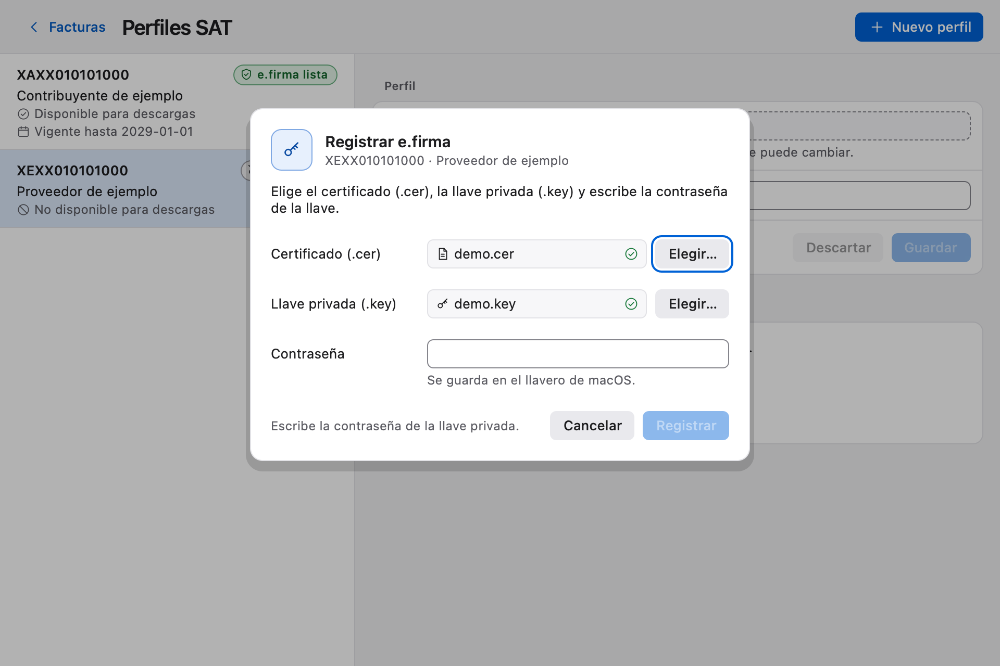
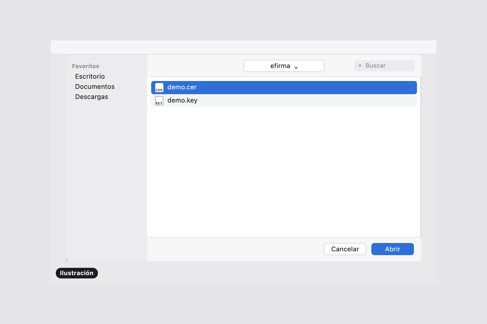
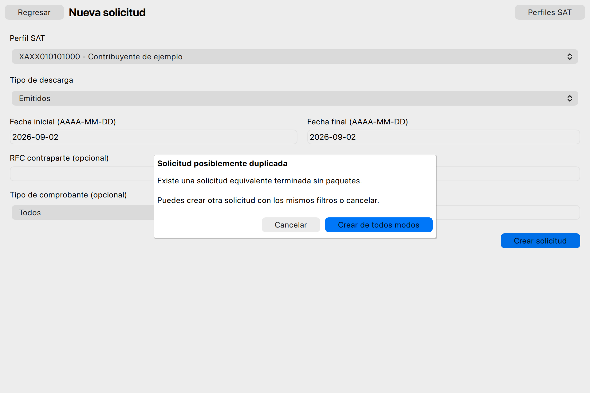
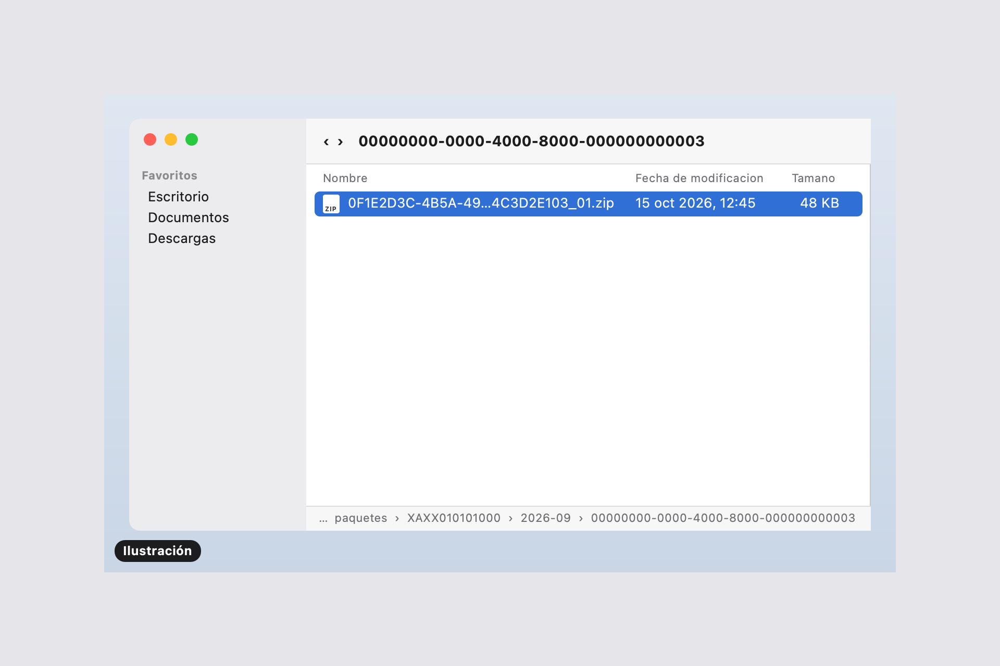

# Archivo Fiscal: manual de usuario

Archivo Fiscal es una aplicación de escritorio para macOS. Sirve para
solicitar al SAT la descarga masiva de CFDI de los contribuyentes que
administras, darle seguimiento a cada solicitud y guardar en tu equipo los
paquetes ZIP que entrega el SAT. Todo se guarda localmente: perfiles,
solicitudes, historial y paquetes. La e.firma se guarda cifrada y su contraseña
queda en el llavero de macOS.

Las imágenes de este manual usan solo datos ficticios: RFC genéricos del SAT
(`XAXX010101000`, `XEXX010101000`), identificadores inventados, archivos
`demo.cer` y `demo.key` y rutas bajo `/Users/usuario/...`. Las imágenes
marcadas como **Ilustración** son dibujos simplificados de elementos de macOS
(menu bar, notificaciones, Finder y selector de archivos). Muestran los mismos
textos que la app y el icono del menu bar es el mismo dibujo, aunque su aspecto
puede variar respecto de macOS.

La app muestra las fechas en formato legible, por ejemplo "3 sep 2026" o
"1 oct 2026, 10:35". Las fechas del formulario de nueva solicitud se escriben
en formato AAAA-MM-DD.

Contenido:

1. [Perfiles SAT y e.firma](#1-perfiles-sat-y-efirma)
2. [Crear una nueva solicitud y resolver duplicados](#2-crear-una-nueva-solicitud-y-resolver-duplicados)
3. [Envío y monitoreo](#3-envío-y-monitoreo)
4. [Seguimiento en la lista de solicitudes](#4-seguimiento-en-la-lista-de-solicitudes)
5. [Detalle: resumen, paquetes, datos e historial](#5-detalle-resumen-paquetes-datos-e-historial)
6. [Paquetes en Finder](#6-paquetes-en-finder)
7. [Menu bar](#7-menu-bar)
8. [Notificaciones de macOS](#8-notificaciones-de-macos)
9. [Respaldo y restauración](#9-respaldo-y-restauración)
10. [Exportar facturas](#10-exportar-facturas)
11. [Mensajes frecuentes y cómo resolverlos](#11-mensajes-frecuentes-y-cómo-resolverlos)

## 1. Perfiles SAT y e.firma

Un perfil SAT representa a un contribuyente: su RFC y un nombre descriptivo.
Para que un perfil pueda usarse en solicitudes debe estar activo y tener su
e.firma registrada y vigente. Abre la pantalla con el botón **Perfiles SAT**,
que está en la lista de solicitudes y en Nueva solicitud. **‹ Solicitudes** (o
la tecla Escape) regresa a la lista.

La pantalla tiene dos paneles: a la izquierda la lista de perfiles y a la
derecha el perfil seleccionado. Al abrirla queda seleccionado el primer perfil.
Puedes cambiar el ancho de los paneles arrastrando la línea que los separa.

### Crear o editar un perfil

1. Pulsa **Nuevo perfil**.
2. Escribe el **RFC** y un **Nombre descriptivo**, y pulsa **Guardar** en el
   pie del grupo **Perfil**. **Descartar** abandona los cambios. Los dos botones
   se habilitan cuando hay cambios.
3. Selecciona un perfil de la lista para editarlo. En edición solo cambia el
   nombre: el RFC aparece con un candado y la ayuda "El RFC identifica al perfil
   y no se puede cambiar."

Los avisos del formulario aparecen bajo su campo: "Ya existe un perfil con ese
RFC." (la app conserva lo que escribiste), "El RFC no es válido." e "Indica un
nombre para el perfil."

Si todavía no hay perfiles, el panel derecho dice "Aún no hay perfiles SAT" y
ofrece **Nuevo perfil**.

### Estado de la e.firma

Cada perfil de la lista muestra su RFC, su nombre, una etiqueta con el estado
de la e.firma y una línea de disponibilidad. La etiqueta usa color e icono, pero
el estado siempre está escrito.

| Etiqueta | Significado |
| --- | --- |
| Verificando | La app está comprobando la e.firma guardada. |
| Sin e.firma | El perfil no tiene e.firma registrada. |
| e.firma lista | La e.firma está registrada y vigente. |
| e.firma vencida | La e.firma ya no es vigente; hay que reemplazarla. |
| e.firma aún no vigente | La e.firma todavía no entra en vigor. |
| e.firma incompleta en el llavero / e.firma dañada en el llavero | No se pudo leer la e.firma guardada; vuelve a registrarla. |
| Estado no disponible | No se pudo consultar el estado (por ejemplo, con el llavero bloqueado). Usa **Reintentar** en la fila, **Reintentar estado** en el grupo e.firma o la tecla R sobre la fila. |

La línea de disponibilidad dice "Disponible para solicitudes", "No disponible
para solicitudes" o, si el perfil está inactivo, "Inactivo: no disponible para
solicitudes". Si la e.firma tiene vigencia conocida, también aparece "Vigente
hasta AAAA-MM-DD".

En el panel derecho, el grupo **e.firma** repite la etiqueta y explica el
estado: "Lista para solicitudes · Vigente hasta 2026-10-22" o "Este perfil no
tiene e.firma registrada.", seguido de "La e.firma se guarda cifrada y su
contraseña queda en el llavero de macOS." o "Regístrala para poder usar este
perfil en solicitudes."

### Aviso de vencimiento

Cuando a una e.firma lista le quedan 30 días o menos de vigencia, la fila del
perfil muestra junto a "Vigente hasta AAAA-MM-DD" la etiqueta de advertencia
"Vence en N días"; con un día completo dice "Vence en 1 día" y, cuando faltan
menos de 24 horas, "Vence hoy". El grupo **e.firma** del panel derecho repite
la etiqueta junto a "e.firma lista". En la imagen anterior, la e.firma de
XAXX010101000 vence en 21 días.

La e.firma sigue lista y se puede usar en solicitudes hasta esa fecha. Para no
quedarte sin ella, renuévala con el SAT y regístrala con **Reemplazar
e.firma…** (ver [Reemplazar la e.firma](#reemplazar-la-efirma)). Si la nueva
e.firma vence en más de 30 días, la etiqueta desaparece.

Además, la app avisa con la notificación **e.firma por vencer** cuando faltan
30 días y otra vez cuando faltan 7 (ver la [sección 8](#8-notificaciones-de-macos)).
Si la app encuentra una e.firma a 7 días o menos sin haber avisado antes, solo
envía el aviso de 7 días. La app revisa la vigencia al abrirse, cada 24 horas
mientras está abierta y cuando registras o reemplazas una e.firma. Cada aviso
llega una sola vez por e.firma; si la reemplazas, la nueva vuelve a avisar
cuando le toque. Las e.firmas vencidas o que no están listas no generan este
aviso: ya aparecen con su etiqueta y con la notificación **e.firma no
disponible**.

### Registrar la e.firma

1. Selecciona el perfil. Si tienes cambios sin guardar, primero guarda el
   perfil ("Guarda el perfil antes de gestionar su e.firma.").
2. En el grupo **e.firma**, pulsa **Registrar e.firma…**.
3. El diálogo **Registrar e.firma** muestra el RFC y el nombre del perfil, y la
   instrucción "Elige el certificado (.cer), la llave privada (.key) y escribe
   la contraseña de la llave." Pulsa **Elegir…** junto a **Certificado (.cer)**
   y junto a **Llave privada (.key)**. Cada botón abre el selector de archivos
   de macOS. En el campo solo se muestra el nombre del archivo, nunca su ruta;
   sin archivo dice "Ningún archivo".
4. Escribe la **Contraseña** ("Se guarda en el llavero de macOS.").
5. **Registrar** se habilita solo cuando elegiste el certificado, la llave y
   escribiste la contraseña. Mientras tanto, el pie del diálogo dice qué falta:
   "Elige el certificado (.cer).", "Elige la llave privada (.key)." o "Escribe
   la contraseña de la llave privada." Pulsa **Registrar** (o Enter en el campo
   de contraseña).
6. Mientras se valida aparece "Validando e.firma…" y los controles se
   deshabilitan. Al terminar aparece "e.firma registrada." con "`<RFC>` ya está
   disponible para solicitudes." y el botón **Cerrar**.

Si la validación falla, el mensaje aparece bajo el campo que lo causó (por
ejemplo, la contraseña) y el foco va a ese campo. Por seguridad, la app olvida
la selección: los campos vuelven a "Ningún archivo", la contraseña se vacía y
aparece "Vuelve a elegir los archivos y escribe la contraseña."

El campo de contraseña se vacía al enviar, al cancelar, al cerrar el diálogo,
al cambiar de perfil, al salir de la pantalla y al ocultar la ventana.

### Reemplazar la e.firma

Si el perfil ya tiene e.firma, el botón dice **Reemplazar e.firma…**; es el
botón principal cuando la e.firma está vencida, aún no es vigente o no se pudo
leer. Antes de capturar los archivos, la app pide confirmación con "¿Reemplazar
la e.firma de `<RFC>`?" y "La e.firma registrada se reemplazará solo si la
nueva se valida. Si falla, la actual sigue registrada sin cambios." Pulsa
**Continuar** y sigue los mismos pasos que en el registro; el diálogo se llama
**Reemplazar e.firma** y el botón final dice **Reemplazar**. Si el reemplazo
falla, el mensaje termina con "La e.firma anterior sigue registrada sin
cambios." y la lista vuelve a mostrar el estado real de la e.firma anterior.

Los errores al registrar o reemplazar están en la [sección 11](#11-mensajes-frecuentes-y-cómo-resolverlos).

## 2. Crear una nueva solicitud y resolver duplicados

Pulsa **Nueva solicitud** en la lista o **Nueva solicitud…** en el menu bar.

El formulario tiene dos grupos:

1. **Solicitud**
   - **Perfil SAT**: elige el contribuyente. "Solo aparecen perfiles activos
     con la e.firma lista." Si no hay ninguno, la pantalla dice "No hay perfiles
     SAT listos para solicitudes" y "Un perfil necesita estar activo y tener su
     e.firma registrada y vigente.", y ofrece **Administrar perfiles SAT**.
   - **Tipo de descarga**: elige **Emitidos** o **Recibidos** en el selector. Al
     abrir el formulario está en Emitidos.
   - **Periodo**: fecha inicial "a" fecha final, en formato AAAA-MM-DD ("Formato
     AAAA-MM-DD. Incluye ambos días."). Al abrir el formulario se propone del
     primer día del mes actual a hoy.
2. **Filtros opcionales**: **RFC contraparte** ("Cualquiera" si lo dejas
   vacío), **Tipo de comprobante** (Todos, I - Ingreso, E - Egreso, T -
   Traslado, N - Nómina, P - Pago) y **Complemento**.

El pie de la pantalla queda siempre visible: "Al crearla, la app la envía al
SAT con la e.firma del perfil.", con **Cancelar** y **Crear solicitud**. Enter
en un campo de texto también crea la solicitud. **Cancelar**, **‹ Solicitudes**
o Escape vuelven a la lista sin crear nada.

Los avisos aparecen bajo el campo correspondiente: "Selecciona un perfil
SAT.", "Indica una fecha inicial válida (AAAA-MM-DD).", "Indica una fecha final
válida (AAAA-MM-DD).", "La fecha final debe ser igual o posterior a la fecha
inicial." y "El perfil SAT seleccionado ya no está disponible."

Al crearla, la solicitud se guarda en el equipo, se abre su detalle y la app
se encarga del envío al SAT (ver la [sección 3](#3-envío-y-monitoreo)).

### Solicitudes equivalentes

Antes de crear, la app compara los filtros con las solicitudes que ya tienes.

- **Bloqueado**: si ya hay una solicitud equivalente que impide crear otra,
  aparece sobre el formulario "No se puede crear: ya existe una solicitud
  equivalente." seguido del motivo, y el botón **Ver solicitud existente** abre
  su detalle. Motivos: "Hay una solicitud equivalente en curso.", "Hay una
  solicitud equivalente terminada con paquetes pendientes de descargar." y "Ya
  existe una solicitud equivalente terminada y descargada."
- **Requiere confirmación**: el diálogo "¿Crear otra solicitud con los mismos
  filtros?" muestra el motivo y "Puedes crear otra solicitud con los mismos
  filtros o cancelar." **Cancelar** es el botón por omisión (Enter o Escape) y
  no crea nada; **Crear de todos modos** crea la solicitud con los mismos
  filtros. Motivos: "Existe una solicitud equivalente terminada cuyos paquetes
  vencieron.", "Existe una solicitud equivalente terminada sin paquetes.",
  "Existe una solicitud equivalente con envío incierto: el SAT pudo haberla
  recibido.", "Existe una solicitud equivalente que no tuvo éxito." y "Existe
  una solicitud equivalente que eliminaste localmente."

## 3. Envío y monitoreo

Mientras la app está abierta, aunque la ventana esté oculta, un proceso local
hace el trabajo con el SAT en este orden:

1. **Envío**: al crear una solicitud, la app la envía al SAT con la e.firma del
   perfil. Mientras tanto la solicitud aparece como "Enviando".
2. **Verificación**: una vez enviada, consulta periódicamente su estado en el
   SAT (Aceptada por SAT, En proceso SAT, Terminada…).
3. **Descarga**: cuando el SAT termina y hay paquetes, los descarga y los
   guarda en la carpeta de paquetes (ver la [sección 6](#6-paquetes-en-finder)).

Pasos manuales en el resumen del detalle (solo aparece el que aplica):

- **Enviar**: aparece en solicitudes "Creada", por ejemplo si el envío no pudo
  iniciarse. Solo se habilita si la e.firma del perfil está lista; si no, se
  muestra el motivo (por ejemplo "Este perfil no tiene e.firma registrada.
  Regístrala para continuar."). Al pulsarlo se lee "Envío solicitado."
- **Verificar ahora**: aparece en solicitudes enviadas que aún no tienen un
  estado final en el SAT. Muestra "Verificación solicitada. Si el monitoreo
  está pausado, queda pendiente."
- **Reintentar descarga**: aparece si algún paquete está "Disponible" o con
  "Error de descarga". Muestra "Descarga solicitada. Si el monitoreo está
  pausado, queda pendiente."

El monitoreo se pausa y se reanuda desde el menu bar ([sección 7](#7-menu-bar)).
Con el monitoreo en pausa no se trabaja con el SAT: las acciones pedidas se
guardan y el menu bar muestra cuántas hay pendientes ("Pendientes: N").

Una solicitud que terminó en "Envío fallido" o "Envío incierto" no se reenvía.
Si necesitas repetirla, crea una nueva; la app te pedirá confirmar el
duplicado.

## 4. Seguimiento en la lista de solicitudes

La pantalla **Solicitudes** muestra junto al título cuántas solicitudes hay y
las ordena de la más reciente a la más antigua. La tabla tiene las columnas
**Estado**, **Contribuyente** (RFC y nombre del perfil), **Tipo**, **Periodo**,
**Paquetes** y **Creada**. En ventanas angostas se oculta la columna Creada.

Acciones de la lista:

- Haz clic en una fila, o usa las flechas y Enter o Espacio, para abrir el
  detalle.
- **Abrir carpeta de paquetes** (abre en Finder la carpeta donde se guardan los
  paquetes), **Perfiles SAT** y **Nueva solicitud**.

Estados que puede mostrar la etiqueta:

| Estado | Significado |
| --- | --- |
| Creada | Guardada en el equipo; aún no se envía al SAT. |
| Enviando | Se está enviando al SAT. |
| Enviada | El SAT recibió la solicitud; aún no hay estado del SAT. |
| Envío fallido | El SAT rechazó el envío; no se registró en el SAT. |
| Envío incierto | No se sabe si el SAT registró la solicitud; no se reenvía automáticamente. |
| Aceptada por SAT | El SAT aceptó la solicitud y la está atendiendo. |
| En proceso SAT | El SAT está preparando los paquetes. |
| Terminada | El SAT terminó; los paquetes están listos o ya se descargaron. |
| Error SAT | El SAT reportó un error en la solicitud. |
| Rechazada por SAT | El SAT rechazó la solicitud. |
| Vencida | La solicitud venció en el SAT. |

Si la lista no se puede leer, aparece "No se pudo cargar la lista de
solicitudes.", "Tus solicitudes siguen guardadas en este equipo. Intenta
cargarlas de nuevo." y el botón **Reintentar**. Si las notificaciones de macOS
están desactivadas, sobre la tabla aparece el aviso "Las notificaciones están
desactivadas." con "Actívalas en Ajustes del Sistema para recibir avisos cuando
una solicitud termine o falle."

### Primer uso: Empieza en tres pasos

Si todavía no hay solicitudes, en lugar de la tabla aparece la guía **Empieza
en tres pasos**: "Para descargar CFDI del SAT necesitas un perfil con su
e.firma registrada." Cada paso indica si ya está hecho (con una marca) o
pendiente, y tiene un botón que abre su pantalla:

| Paso | Botón | Abre |
| --- | --- | --- |
| Paso 1: Crea un perfil SAT con el RFC del contribuyente | Perfiles SAT | Perfiles SAT ([sección 1](#1-perfiles-sat-y-efirma)). |
| Paso 2: Registra la e.firma del perfil | Registrar e.firma | Perfiles SAT, donde registras la e.firma del perfil ([Registrar la e.firma](#registrar-la-efirma)). |
| Paso 3: Crea tu primera solicitud de descarga | Nueva solicitud | Nueva solicitud ([sección 2](#2-crear-una-nueva-solicitud-y-resolver-duplicados)). |

El botón del primer paso pendiente aparece resaltado y recibe el foco al abrir
la lista. La app comprueba los pasos con lo que ya tienes guardado: el paso 1
está hecho si existe algún perfil SAT (activo o inactivo), el paso 2 si algún
perfil tiene la e.firma lista y el paso 3 si existe alguna solicitud. Por eso
la guía desaparece en cuanto creas tu primera solicitud y vuelve a aparecer si
eliminas todas. Los botones del encabezado siguen disponibles.

Mientras la app comprueba los pasos, o si no pudo comprobarlos, la lista vacía
dice "No hay solicitudes" y "Crea una solicitud para descargar del SAT los CFDI
emitidos o recibidos de un contribuyente.", con el botón **Nueva solicitud**.

## 5. Detalle: resumen, paquetes, datos e historial

El encabezado del detalle dice **Solicitud** con el RFC, el tipo y el periodo
(por ejemplo "XAXX010101000 · Recibidos · 3 sep 2026"). Tiene **‹ Solicitudes**
para volver, **Ver facturas (N)** cuando hay paquetes descargados (ver
[Facturas de la solicitud](#facturas-de-la-solicitud)), **Abrir carpeta de la
solicitud** y, separado, **Eliminar…**.

Debajo, el **resumen** muestra un solo estado (el mismo de la lista) con un
titular y una descripción, por ejemplo "El SAT terminó la solicitud" y "1 de 3
paquetes descargados · 1 disponible · 1 vencido". También muestra
Contribuyente, Tipo · periodo, CFDI reportados y Última verificación, y la
acción principal que aplica: **Enviar**, **Verificar ahora** o **Reintentar
descarga** (ver la [sección 3](#3-envío-y-monitoreo)). Cuando todos los
paquetes están descargados, la acción es **Abrir carpeta de la solicitud**.

| Estado | Titular |
| --- | --- |
| Creada | La solicitud aún no se envía al SAT |
| Enviando | Enviando la solicitud al SAT… |
| Enviada | El SAT recibió la solicitud |
| Aceptada por SAT | El SAT aceptó la solicitud |
| En proceso SAT | El SAT está preparando los paquetes |
| Terminada | El SAT terminó la solicitud / Todos los paquetes están descargados / Hay un paquete con error de descarga / El SAT terminó sin paquetes |
| Envío fallido | El SAT rechazó el envío |
| Envío incierto | No se sabe si el SAT registró la solicitud |
| Error SAT | El SAT reportó un error en la solicitud |
| Rechazada por SAT | El SAT rechazó la solicitud |
| Vencida | La solicitud venció en el SAT |

Bajo el resumen hay tres pestañas:

- **Paquetes**: uno por paquete del SAT, con su estado de descarga, sus fechas
  y un mensaje cuando hace falta. Es la pestaña inicial si hay paquetes.
- **Datos**: secciones **Estado** (Resumen, Estado local, Estado SAT y Último
  error; si el SAT aún no responde dice "Sin respuesta del SAT"), **SAT** (Id
  solicitud SAT, Código de solicitud SAT, Código de verificación SAT, CFDI
  reportados, Enviada y Última verificación), **Solicitud** (Identificador
  local, Perfil, Tipo de descarga y Creada) y **Filtros** (Periodo, RFC
  contraparte, Tipo de comprobante y Complemento).
- **Historial**: los eventos de la solicitud con fecha, descripción y origen
  (Usuario, Automático o Recuperación).

Estados de un paquete:

| Estado | Significado |
| --- | --- |
| Disponible | El SAT lo tiene listo: "La app lo descargará automáticamente." |
| Descargando | Se está descargando. |
| Descargado | Ya está guardado en el equipo. |
| Error de descarga | No se pudo descargar ("No se pudo descargar el paquete. Puedes reintentar." o "El paquete alcanzó el máximo de descargas permitidas."; en este último caso no aparece **Reintentar descarga**). |
| Vencido | "El paquete ya no existe en el SAT (vencido). Crea una solicitud nueva para el mismo periodo." |

En los paquetes descargados, la app comprueba el archivo local y muestra
"Archivo local presente", "Archivo local no encontrado: el ZIP se movió o se
borró fuera de la app." o "No se pudo comprobar el archivo local". **Mostrar en
Finder** solo se habilita si el archivo está presente.

**Eliminar…** pide confirmación: "¿Eliminar esta solicitud?", "La solicitud se
eliminará de esta aplicación. No se modifica nada en el SAT." y "Los ZIP ya
descargados se quedan en su carpeta." **Cancelar** es el botón por omisión.
Después de eliminarla vuelves a la lista. Si abres una solicitud que ya no
existe, el detalle dice "Solicitud no encontrada" y "La solicitud no existe o
fue eliminada."

### Facturas de la solicitud

**Ver facturas (N)** aparece en el encabezado del detalle solo si la solicitud
tiene al menos un paquete descargado; N es el número de CFDI que la app ya leyó
de sus ZIP. Mientras la app todavía lee paquetes, el número puede crecer (o
verse solo **Ver facturas**). La app lee los XML dentro de los ZIP sin
extraerlos ni modificarlos.

La pantalla **Facturas** muestra los CFDI de esa solicitud, del más reciente al
más antiguo, con estas columnas:

- **Fecha**: fecha del CFDI y, debajo, el tipo (Ingreso, Egreso, Traslado,
  Nómina o Pago) con la serie y el folio.
- **Emisor** y **Receptor**: RFC y nombre. En ventanas angostas se oculta
  Receptor.
- **Total**: el importe tal como viene en el XML y, debajo, la moneda y el
  método de pago.
- **UUID**: los primeros 8 caracteres del folio fiscal, con un botón para
  copiarlo completo, y el estado de lectura: Completo, Parcial (hay datos o
  complementos que la app no representa), Versión no soportada o Ilegible.

**Buscar** encuentra por RFC, nombre, UUID (completo o parcial) o serie y folio,
sin importar mayúsculas ni acentos; la lista se actualiza al dejar de escribir.
El filtro de tipo deja solo Ingreso, Egreso, Traslado, Nómina o Pago. Si nada
coincide, la pantalla dice "Ninguna factura coincide con la búsqueda" con
**Limpiar filtros**.

Sobre la lista pueden aparecer avisos, en este orden; ninguno detiene la
pantalla y la lista sigue mostrando las facturas ya leídas:

| Aviso | Qué significa |
| --- | --- |
| Indexando N paquetes… | La app aún está leyendo esos paquetes; las facturas aparecen conforme termina. |
| N paquetes no disponibles (ZIP faltante) | El ZIP se movió o se borró fuera de la app. |
| N paquetes ilegibles | El ZIP está dañado o no se pudo leer. |
| N CFDI ilegibles o no soportados | Algunos XML no se pudieron leer o son de una versión que la app no representa. |

Los tres últimos avisos traen **Abrir carpeta de la solicitud** para revisar
los ZIP en Finder. Si la solicitud no tiene facturas que mostrar, la pantalla
dice "Sin facturas". Si la app no puede leer la lista, dice "No se pudo leer la
lista de facturas." con **Reintentar**.

Con el teclado: Tab pasa por la búsqueda, el filtro, **Ver PDF** y la lista;
las flechas mueven la selección; Enter abre el PDF de la factura seleccionada;
⌘F lleva a la búsqueda; ⌘C copia el UUID de la factura seleccionada; Escape (o
**‹ Solicitud**) regresa al detalle.

### Ver el PDF de una factura

Para ver una factura, selecciónala y pulsa Enter, haz doble clic sobre ella o
usa **Ver PDF**. La app genera en tu equipo un PDF con los datos del XML:
emisor, receptor, conceptos, impuestos, totales, el timbre fiscal y el código
QR de verificación del SAT. Mientras lo prepara, la pantalla dice "Generando el
PDF…"; la siguiente vez que abras la misma factura aparece al instante.

El PDF es una **visualización generada localmente**: no es la representación
impresa que emite el contribuyente ni valida el sello, la vigencia o la
cancelación. El comprobante fiscal sigue siendo el XML dentro del ZIP. El PDF
lo indica con una leyenda.

En la vista del PDF:

- **Guardar PDF…** abre el diálogo de macOS para elegir dónde guardar una
  copia; el nombre sugerido es `CFDI-<serie y folio>-<inicio del UUID>.pdf`,
  sin RFC ni nombres. Al terminar, la app dice "PDF guardado como …". Si no se
  pudo guardar, lo dice ahí mismo y nada más cambia.
- **Abrir en Vista Previa** abre el PDF en la app Vista Previa de macOS (para
  imprimirlo, por ejemplo). Si no se pudo abrir, la app muestra el motivo.
- Si el PDF tiene varias páginas, desplázate hacia abajo; la esquina inferior
  indica "Página N de M". ⌘+ y ⌘− cambian el zoom y ⌘0 lo ajusta al ancho.
- Escape (o **‹ Facturas**) regresa a la lista con la misma factura
  seleccionada.

Si la app no puede generar el PDF, lo dice en lugar del documento:

| Mensaje | Qué hacer |
| --- | --- |
| El ZIP de esta factura no está disponible. | El ZIP se movió o se borró fuera de la app. Revisa la carpeta de la solicitud y pulsa **Reintentar**. |
| La app no representa esta versión de CFDI. / No se pudo leer el XML de esta factura. | No hay PDF para esa factura; el XML sigue en el ZIP de la solicitud. |
| No se pudo generar el PDF. / Se canceló la generación del PDF. | Pulsa **Reintentar**. |
| No se pudo mostrar el PDF. | Pulsa **Reintentar** o usa **Abrir en Vista Previa**. |

## 6. Paquetes en Finder

Los paquetes se guardan como ZIP en la carpeta `Archivo-Fiscal/paquetes`
de tu carpeta de usuario, organizados por RFC, mes de la solicitud e
identificador local. La app no abre ni modifica los ZIP.

Si usabas la app con su nombre anterior, tus paquetes estaban en
`SAT-CFDI-Downloader/paquetes`. Al abrirla por primera vez con el nombre
nuevo, la app mueve esa carpeta a `Archivo-Fiscal/paquetes` sin copiar ni
borrar ningún ZIP. Si no puede hacerlo (por ejemplo, porque las dos carpetas
ya tienen contenido), sigue usando la carpeta anterior y te avisa en la
ventana con las dos rutas para que decidas qué hacer.

Hay tres formas de llegar a ellos:

- **Mostrar en Finder**, en un paquete Descargado de la pestaña Paquetes, abre
  Finder con el ZIP seleccionado.
- **Abrir carpeta de la solicitud**, en el detalle, abre la carpeta con los
  paquetes de esa solicitud.
- **Abrir carpeta de paquetes**, en la lista o en el menu bar, abre la carpeta
  principal de paquetes.

Si el destino no existe o Finder no responde, la app lo avisa con "Archivo
local no encontrado", "Carpeta de paquetes no encontrada" o "No se pudo abrir
Finder". Estas acciones no cambian ningún estado.

## 7. Menu bar

La app pone un icono en la barra de menús de macOS. Cerrar la ventana solo la
oculta: la app y el monitoreo siguen activos. Haz clic en el icono para abrir
su menú; el icono también indica el estado de la app (ver [El icono y su
estado](#el-icono-y-su-estado)).

| Opción | Para qué sirve |
| --- | --- |
| Mostrar ventana | Muestra y trae al frente la ventana principal. |
| Nueva solicitud… | Muestra la ventana en el formulario de nueva solicitud. |
| Abrir carpeta de paquetes | Abre en Finder la carpeta de paquetes. |
| Monitoreo activo / Monitoreo en pausa / Trabajando: enviando… / Trabajando: verificando… / Trabajando: descargando… | Línea informativa con lo que hace el monitoreo. |
| Pendientes: N | Acciones guardadas durante una pausa; solo aparece si hay alguna. |
| Pausar monitoreo / Reanudar monitoreo | Detiene o reanuda el trabajo con el SAT. La pausa se recuerda al volver a abrir la app. |
| Abrir al iniciar sesión | Abre la app al iniciar sesión en macOS, sin mostrar la ventana. |
| Estado en macOS: … | Lo que macOS reporta para ese inicio automático: habilitado, deshabilitado, pendiente de aprobación, rechazado o no disponible. Si está pendiente o rechazado aparece **Abrir ajustes de inicio de sesión…** |
| Notificaciones: … | Permiso de notificaciones: sin permiso solicitado, permitidas, deshabilitadas o no disponibles. Según el caso aparecen **Solicitar permiso de notificaciones**, **Enviar notificación de prueba** o **Abrir ajustes de notificaciones…** |
| Salir de Archivo Fiscal | Termina la app de forma ordenada: espera la operación en curso y cierra. |

### El icono y su estado

El icono es un documento con una flecha de descarga. Es un icono monocromo de
macOS, que se adapta a la apariencia clara u oscura, así que el estado se
distingue por la insignia de la esquina inferior derecha y por el texto que
aparece al pasar el cursor sobre el icono (VoiceOver lee el mismo texto):

| Icono | Al pasar el cursor | Cuándo aparece |
| --- | --- | --- |
| Sin insignia | Archivo Fiscal | Normal: el monitoreo está activo, no hay trabajo en curso y nada requiere atención. |
| Dos barras (pausa) | Archivo Fiscal: en pausa | El monitoreo está en pausa. |
| Flecha circular | Archivo Fiscal: trabajando | La app está trabajando con el SAT: enviando, verificando o descargando. |
| Punto sólido | Archivo Fiscal: requiere atención | Hay algo que debes revisar (ver la lista siguiente). |

Si se cumplen varios estados a la vez, el icono muestra el de mayor prioridad:
primero requiere atención, después trabajando, después en pausa y, por último,
normal. Por ejemplo, con el monitoreo en pausa y una solicitud en Error SAT, el
icono muestra el punto.

Cuenta como "requiere atención":

- una solicitud en Error SAT, Rechazada por SAT, Envío fallido o Envío incierto;
- una solicitud con algún paquete en Error de descarga;
- un perfil activo cuya e.firma no está lista: Sin e.firma, e.firma vencida,
  e.firma aún no vigente, e.firma incompleta o dañada en el llavero, o Estado
  no disponible.

No cuentan una solicitud Vencida, un perfil inactivo, una e.firma lista con la
etiqueta "Vence en N días" ni un perfil en "Verificando", que solo dura
mientras la app comprueba la e.firma. Para encontrar lo que requiere atención,
revisa los estados de la lista de solicitudes y de Perfiles SAT.

## 8. Notificaciones de macOS

Con el permiso concedido, la app avisa con notificaciones de macOS de estos
cambios. Cada notificación tiene un título y un texto:

- **Solicitud terminada**: "El SAT terminó la solicitud con 3 paquetes."
- **Descarga completa**: "1 de 1 paquetes descargados."
- **Error en el SAT**: "El SAT reportó un error en la solicitud."
- **Solicitud rechazada**: "El SAT rechazó la solicitud."
- **Solicitud vencida**: "La solicitud venció en el SAT; los paquetes pueden ya
  no estar disponibles."
- **e.firma no disponible**: la e.firma de un perfil dejó de estar lista. El
  texto explica la causa, termina con "El monitoreo de ese perfil está en
  pausa." y en otra línea indica qué hacer: "Reemplázala en Perfiles SAT." o
  "Regístrala en Perfiles SAT."
- **e.firma por vencer**: a la e.firma de un perfil le quedan 30 días o menos
  (ver [Aviso de vencimiento](#aviso-de-vencimiento)). Por ejemplo, "La e.firma
  vence en 21 días (22 oct 2026)." y en otra línea "RFC \*\*\*000 ·
  Reemplázala en Perfiles SAT." Si faltan menos de dos días, dice "La e.firma
  vence en 1 día (…)." o "La e.firma vence hoy (…)."

Las notificaciones de solicitudes agregan una segunda línea con el tipo de
descarga, el periodo y el RFC abreviado a sus últimos tres caracteres, por
ejemplo "Recibidos · 3 sep 2026 · RFC \*\*\*000".

### Pulsar una notificación

Al pulsar una notificación, la app pasa al frente y abre la pantalla
relacionada:

- **Solicitud terminada**, **Descarga completa**, **Error en el SAT**,
  **Solicitud rechazada** y **Solicitud vencida** abren el detalle de esa
  solicitud. Si la solicitud ya no existe (por ejemplo, porque la eliminaste),
  abren la lista de solicitudes, sin mensaje de error.
- **e.firma no disponible** y **e.firma por vencer** abren Perfiles SAT con ese
  perfil seleccionado.

Algunas notificaciones tienen además un botón de acción. macOS lo muestra en
**Opciones** al pasar el cursor sobre la notificación, también en el Centro de
notificaciones:

- **Mostrar en Finder**, en **Descarga completa**: abre en Finder la carpeta de
  la solicitud, igual que **Abrir carpeta de la solicitud** en el detalle. No
  crea carpetas ni abre los ZIP. Si Finder no puede mostrar la carpeta, la app
  abre el detalle de la solicitud (o la lista, si ya no existe) con el aviso
  correspondiente.
- **Abrir Perfiles SAT**, en **e.firma no disponible** y **e.firma por
  vencer**: abre Perfiles SAT con ese perfil seleccionado.

Esto funciona igual con la ventana abierta, con la ventana oculta o con la app
cerrada: si la app no estaba abierta, macOS la abre y la app va a la pantalla
correspondiente en cuanto termina de arrancar. Las notificaciones que recibiste
con una versión anterior de la app no llevan esta información: al pulsarlas
solo se muestra la ventana de la app.

### Comprobar las notificaciones

Para comprobar las notificaciones usa **Enviar notificación de prueba** en el
menu bar. Si las desactivas en Ajustes del Sistema, la app sigue funcionando
igual; solo deja de avisar y la lista muestra un aviso.

## 9. Respaldo y restauración

Archivo Fiscal puede guardar una copia cifrada de tus datos (perfiles,
solicitudes, historial y paquetes ZIP) en una carpeta que tú eliges, por
ejemplo una carpeta de iCloud Drive o de Dropbox. La app solo copia el
respaldo a esa carpeta; el servicio de nube, si la sincroniza, se encarga de lo
demás por su cuenta. Por eso la app dice "copiado a la carpeta" y no puede confirmar qué hizo
tu servicio de nube con el archivo.

Abre la pantalla con **Ir > Respaldo** o con ⌘4. **‹ Atrás** (o la tecla
Escape) regresa a la pantalla de la que venías.

> Las capturas de esta sección se agregarán cuando se regraben el manual y el
> video tutorial (T024).

### Elegir la carpeta

En **Carpeta**, pulsa **Elegir carpeta…** y elige la carpeta en el selector de
macOS, por ejemplo `/Users/usuario/Library/Mobile Documents/com~apple~CloudDocs/Respaldos`
o `/Users/usuario/Dropbox/Respaldos`. La pantalla muestra solo el nombre de la
carpeta ("Las copias se guardan en «Respaldos».") y la app confirma con
"Carpeta del respaldo guardada.". Puedes cambiarla después con **Cambiar
carpeta…**.

Elige una carpeta en un disco de tu Mac o en un disco externo con formato de
macOS. Un disco con formato exFAT no es compatible.

### Contraseña y clave de recuperación

Los respaldos siempre se cifran. En **Contraseña**, pulsa **Crear
contraseña…**, escríbela dos veces y pulsa **Crear contraseña**. La contraseña
debe tener al menos 12 caracteres. Archivo Fiscal
no guarda tu contraseña en texto: la protege en el llavero de macOS de este
equipo.

Al crearla, la app muestra **Guarda tu clave de recuperación**. Con esa clave
puedes abrir tus respaldos si olvidas la contraseña:

- No se volverá a mostrar después de que confirmes que la guardaste. Este
  diálogo no se cierra con Escape: cuando la hayas guardado, pulsa **Ya la
  guardé**.
- **Copiar** la deja en el portapapeles de este equipo durante 90 segundos;
  después se borra y no pasa a tus otros dispositivos.
- **Imprimir…** abre el panel de impresión de macOS. Ese panel también permite
  **Guardar como PDF** o abrirla en Vista Previa, y la cola de impresión puede
  conservar una copia. Archivo Fiscal no la guarda. Lo más seguro es anotarla o
  imprimirla y guardar el papel en un lugar seguro.
- Si sales de Respaldo antes de pulsar **Ya la guardé** (por ejemplo, desde el
  menu bar o una notificación), la clave no se pierde: la ventana muestra
  **Guarda tu clave de recuperación** y **Ver la clave** vuelve a abrir el
  diálogo.
- Si pierdes la contraseña y también la clave de recuperación, no podrás
  abrir tus respaldos.

### Cambiar la contraseña

Pulsa **Cambiar contraseña…**. Elige si te identificas con la **Contraseña
anterior** o con la **Clave de recuperación**, escríbela y después escribe dos
veces la contraseña nueva, de al menos 12 caracteres. La clave de recuperación **no cambia**: la app
confirma con "Contraseña cambiada. Tu clave de recuperación sigue siendo la
misma.". Las copias anteriores se abren con la contraseña anterior o con la
clave; las nuevas, con la contraseña nueva o con la clave.

### Respaldo diario

Activa **Respaldar una vez al día mientras la aplicación esté abierta** para
que la app haga un respaldo cada día por su cuenta. Mientras falte algo, la
pantalla lo indica: "El respaldo diario empezará cuando elijas una carpeta." o
"El respaldo diario empezará cuando crees una contraseña.". El resultado del
último respaldo, manual o diario, se muestra en la pantalla al volver a
abrirla.

### Respaldar ahora

Con la carpeta y la contraseña listas, pulsa **Respaldar ahora**. Mientras
trabaja, la pantalla muestra el paso ("Preparando la copia de tus datos…",
"Cifrando y copiando a la carpeta…", "Terminando la copia…", "Depurando
copias anteriores…") y una barra de progreso. Solo corre un respaldo a la vez.

Al terminar verás uno de estos avisos:

- **Respaldo copiado a la carpeta**, con la fecha y el tamaño: la copia
  cifrada quedó en la carpeta elegida.
- **Respaldo copiado a la carpeta, con avisos**: la copia es válida, pero
  debajo se explica algo que conviene revisar, por ejemplo "2 paquetes ya no
  estaban en este equipo y no se incluyeron." o "La copia es válida, pero
  algunas copias anteriores requieren revisión manual.".
- **No se creó el respaldo**, con la causa (ver [Respaldo y
  restauración](#respaldo-y-restauración) en Mensajes frecuentes). Tus datos
  no cambian.

La app conserva las últimas 5 copias y borra las anteriores que ella misma
creó.

### Copias que hay que borrar a mano

Si una copia anterior no está descargada en este equipo (por ejemplo, porque
usaste **Quitar descarga** en iCloud Drive) y la app no tiene registro de
ella, no la borra. En ese caso aparece **Revisa la carpeta del respaldo** con
el texto "Hay 2 copias anteriores que no están descargadas en este equipo y
Archivo Fiscal no puede confirmar que sean suyas, así que no se borraron. Si
ya no las necesitas, bórralas a mano desde la carpeta.". Abre la carpeta en
Finder y borra las copias que ya no necesites.

### Restaurar un respaldo

Restaurar **sustituye** los datos de este equipo por los del respaldo; no los
combina. Puedes restaurar en la misma Mac o en otra.

1. En **Restaurar**, pulsa **Restaurar un respaldo…** y luego **Elegir
   archivo…**. El selector se abre en la carpeta del respaldo, si ya la
   elegiste. Elige el archivo `.afbak` del respaldo, por ejemplo en
   `/Users/usuario/Dropbox/Respaldos`.
2. Escribe la contraseña o la clave de recuperación de ese respaldo y pulsa
   **Verificar respaldo**. La app revisa todo el archivo antes de tocar nada;
   si está en la nube, puede tardar mientras se descarga. Puedes pulsar
   **Cancelar verificación** (o Escape) en cualquier momento.
3. Revisa el resumen: **Fecha del respaldo**, **Identificador**, **Contenido**
   (por ejemplo "2 perfiles, 5 solicitudes y 1 paquete.") y la versión con la
   que se creó. Si no es el respaldo que buscas, pulsa **Descartar**.
4. Pulsa **Restaurar y reiniciar…** y confirma con **Restaurar y reiniciar**.
   La app se cierra y debería abrirse sola para aplicar la restauración.

Si la app no se abre sola, ábrela de nuevo: la restauración se aplica en cuanto
la abras. Si al pulsar Restaurar y reiniciar la app avisa "La aplicación se
cerrará y no podrá abrirse sola.", ábrela tú cuando se cierre. Al abrirse muestra arriba de la ventana **Restauración aplicada**, con
la fecha del respaldo; pulsa **Entendido** para cerrar el aviso. Si el
respaldo preparado cambió o no se pudo completar la restauración, el aviso dice
**Restauración descartada** o **Restauración revertida** y tus datos actuales
no se modifican.

La e.firma **no** se restaura. Después de restaurar, registra de nuevo la
e.firma de cada perfil en Perfiles SAT (ver [Registrar la
e.firma](#registrar-la-efirma)); hasta entonces la app no se comunica con el
SAT para ese perfil. La configuración del respaldo de este equipo (carpeta,
contraseña y respaldo diario) tampoco cambia.

### Datos anteriores a una restauración

Al restaurar, tus datos anteriores no se borran: se guardan aparte en carpetas
`pre-restauracion-<fecha>`. Mientras existan, la ventana muestra el aviso
**Hay datos anteriores a una restauración** y las e.firmas anteriores se
conservan en el llavero de macOS. El botón **Revisar en Respaldo** del aviso
abre la pantalla Respaldo.

Cuando ya no los necesites, pulsa **Descartar datos anteriores…** en Respaldo y
confirma con **Descartar**. No se puede deshacer. Solo se borran las carpetas
que creó Archivo Fiscal; cualquier otra carpeta con un nombre parecido, o que
sea un enlace, queda intacta y la app te avisa para que la revises a mano.
Después se limpian del llavero las e.firmas anteriores.

## 10. Exportar facturas

Desde **Facturas** puedes guardar en un solo archivo ZIP las facturas que ya
están en tu equipo, para entregarlas o guardarlas donde tú quieras. La app no
se conecta al SAT para exportar: usa solo lo que ya descargó.

Hay tres formas de elegir qué exportar:

- **Este mes**: pulsa **Exportar este mes**. Se exportan las facturas del mes
  que estás viendo.
- **Varios meses**: en el diálogo, elige **Varios meses** e indica **Desde** y
  **Hasta**. Puede ser el mismo mes en los dos. El rango no puede incluir meses
  que todavía no empiezan ni meses fuera de los que se pueden consultar en
  Facturas (los últimos 6 años), y el mes inicial no puede ser posterior al
  final; si pasa, el diálogo lo dice debajo del rango y no deja exportar.
- **Elegidas**: pulsa **Elegir facturas**. Cada fila muestra una casilla;
  márcala con un clic o, con la fila seleccionada, con la barra espaciadora.
  Arriba se ve cuántas llevas ("3 facturas elegidas"). Lo elegido se conserva
  al cambiar entre Emitidas y Recibidas, al buscar o filtrar y cuando la lista
  se actualiza, pero se borra al cambiar de perfil. **Quitar selección** desmarca todo;
  **Listo** o Escape salen del modo de selección. Pulsa **Exportar
  elegidas…** para abrir el diálogo.

### El diálogo Exportar facturas

El diálogo siempre muestra este aviso:

> El archivo que vas a crear contiene tus facturas completas y no está
> protegido con contraseña. Cualquier persona que lo abra podrá verlas. Si lo
> guardas en iCloud Drive, Dropbox o una carpeta compartida, se copiará fuera
> de este equipo. Guárdalo en un lugar de confianza y bórralo cuando ya no lo
> necesites.

Debajo eliges:

- **Qué exportar**: **Este mes**, **Varios meses** o **Elegidas (N)**.
- **Facturas a exportar** (solo para un mes o varios): **Emitidas**,
  **Recibidas** o **Ambas**. Por omisión, la pestaña que estabas viendo. Con
  facturas elegidas no hay que elegir: se exporta exactamente lo que marcaste.
- **Incluir el PDF de cada factura**: agrega junto a cada XML el mismo PDF que
  ves en **Ver PDF**.
- Cuántas facturas se exportarán ("Se exportarán 12 facturas."). Si alguna no
  está en tu equipo, o un mes tiene descargas pendientes o incompletas, el
  diálogo lo avisa antes de exportar. Si no hay ninguna, dice "No hay facturas
  para exportar" y **Exportar** queda deshabilitado; no se crea un archivo
  vacío.
- **Guardar en**: pulsa **Elegir carpeta…** para elegir la carpeta con el
  diálogo de macOS. No puede ser una carpeta dentro de los datos de Archivo
  Fiscal.
- **Nombre del archivo**: la app sugiere uno sin RFC ni nombres, por ejemplo
  `Archivo-Fiscal-2026-09.zip`, `Archivo-Fiscal-2026-08_2026-09.zip` para
  varios meses o `Archivo-Fiscal-seleccion-2026-10-26.zip` para facturas
  elegidas. Puedes cambiarlo; la app quita los caracteres que macOS no admite y
  agrega `.zip` si falta.

**Exportar** se habilita cuando hay facturas y una carpeta elegida. **Cancelar**
o Escape cierran el diálogo sin crear nada.

### Mientras se exporta

El diálogo muestra la etapa ("Agregando facturas…", "Creando los PDF…",
"Terminando el archivo…") con una barra y el conteo de facturas exportadas.
**Cancelar exportación** (o Escape) detiene el trabajo: no queda ningún archivo
a medias en la carpeta. Solo corre una exportación a la vez.

### Si el nombre ya existe

La app nunca reemplaza un archivo. Si en la carpeta ya hay uno con ese nombre,
el diálogo dice "Ya existe un archivo con ese nombre en la carpeta. Escribe otro
nombre.", con el foco en **Nombre del archivo**. Escribe otro nombre y pulsa
**Guardar con este nombre** (no se vuelve a preparar el archivo) o pulsa
**Cancelar exportación** para descartarlo.

### Resultado y contenido del ZIP

Al terminar, el diálogo dice "Exportación terminada" con el número de facturas
exportadas (y de PDF, si los pediste) y el nombre del archivo creado. Si
algunas facturas no se incluyeron o salieron sin PDF, lo indica con su conteo.
Si no se pudo leer ninguna factura, dice "No se exportó ninguna factura" y el
ZIP solo contiene `omitidas.txt`.

Dentro del ZIP:

- `emitidas/AAAA-MM/<UUID>.xml` y `recibidas/AAAA-MM/<UUID>.xml`: el XML
  original de cada factura, sin cambios, agrupado por el mes que ves en
  Facturas. Con PDF, `<UUID>.pdf` va junto a su XML. El PDF es una
  visualización generada en tu equipo, igual que en **Ver PDF**; el comprobante
  fiscal es el XML.
- `omitidas.txt`, solo si algo no se exportó completo: una línea por factura
  con su UUID y el motivo ("no disponible en este equipo", "ilegible", "cambió
  desde que se indexó", "ya no disponible" o "sin PDF" cuando el XML sí se
  incluyó), y una línea por mes con descargas pendientes o cobertura
  incompleta. No incluye RFC, nombres ni rutas.

Una factura cuyo ZIP original falta en tu equipo o todavía se está
descargando no se exporta y aparece en `omitidas.txt`. Si acabas de descargar
el mes, espera a que termine y exporta de nuevo.

Con el teclado: Tab recorre el diálogo en orden (qué exportar, facturas a
exportar, PDF, carpeta, nombre, **Cancelar** y **Exportar**); las flechas
cambian de opción en los selectores; Escape cierra o cancela según el momento.

## 11. Mensajes frecuentes y cómo resolverlos

### e.firma (al registrar o reemplazar)

Tras cualquiera de estos errores, vuelve a elegir los archivos y a escribir la
contraseña.

| Mensaje | Qué hacer |
| --- | --- |
| No se pudo leer el certificado o la llave. / El certificado o la llave no tienen un formato válido. | Elige otra vez el `.cer` o la `.key`; el foco va al archivo con problema. |
| La contraseña de la llave privada es incorrecta. | Escribe de nuevo la contraseña. |
| El certificado y la llave privada no corresponden. | Usa el `.cer` y la `.key` de la misma e.firma. |
| El RFC del certificado no coincide con el del perfil. | Usa la e.firma del contribuyente de ese perfil. |
| El certificado no es una e.firma admisible. | Usa el certificado de e.firma del contribuyente. |
| La e.firma está vencida. / La e.firma aún no es vigente. | Usa una e.firma vigente. |
| El llavero está bloqueado; intenta de nuevo tras desbloquear la sesión. / Se denegó el acceso al llavero. / La operación se canceló. | Desbloquea tu sesión o permite el acceso en el aviso de macOS e intenta de nuevo. |
| El perfil está inactivo; no se puede registrar su e.firma. | Solo los perfiles activos pueden registrar e.firma. |

### Envío y verificación

| Mensaje | Qué hacer |
| --- | --- |
| Este perfil no tiene e.firma registrada. Regístrala para continuar. | Registra la e.firma en Perfiles SAT y pulsa **Enviar**. |
| La e.firma de este perfil está vencida. Reemplázala para continuar. | Reemplaza la e.firma y pulsa **Enviar**. |
| No se pudo leer la e.firma guardada. Vuelve a importarla. | Vuelve a registrar la e.firma del perfil. |
| El llavero de macOS está bloqueado. Desbloquea tu sesión e intenta de nuevo. | Desbloquea la sesión e intenta de nuevo. |
| El SAT no aceptó la autenticación con esta e.firma. | Revisa que la e.firma sea la correcta y esté vigente. |
| No se pudo conectar con el SAT para autenticar. Intenta más tarde. / No se pudo conectar con el SAT; la solicitud no se envió. | Revisa tu conexión; la solicitud queda en Creada y puedes pulsar **Enviar** después. |
| El SAT rechazó la solicitud (código N). No se registró en el SAT. | Revisa los filtros y crea una solicitud nueva si hace falta. |
| No estás autorizado para descargar estos CFDI (5001). | La e.firma no tiene permiso sobre esos CFDI. |
| El SAT ya no acepta solicitudes con este mismo criterio. (5002) | Cambia los filtros. |
| La consulta supera el máximo de CFDI; usa un rango más corto. (5003) | Divide el periodo. |
| El SAT ya tiene una solicitud activa con este criterio. (5005) | Espera a la solicitud existente. |
| Se alcanzó el límite diario del SAT. Intenta mañana. (5011) | Intenta al día siguiente. |
| No se sabe si el SAT registró la solicitud. No se reenviará automáticamente; revisa antes de crear otra. | Revisa con el SAT antes de crear otra; la app pedirá confirmar el duplicado. |
| No se pudo consultar el estado; se reintentará automáticamente. | No hace falta hacer nada; también puedes usar **Verificar ahora**. |
| El SAT no encontró esta solicitud. La verificación automática se detuvo. | Crea una solicitud nueva si todavía la necesitas. |

### Paquetes y archivos

| Mensaje | Qué hacer |
| --- | --- |
| No se pudo descargar el paquete. Puedes reintentar. | Pulsa **Reintentar descarga**. |
| El paquete alcanzó el máximo de descargas permitidas. | El SAT ya no permite descargarlo de nuevo. |
| El paquete ya no existe en el SAT (vencido). Crea una solicitud nueva para el mismo periodo. | Crea una solicitud nueva para el mismo periodo. |
| No hay espacio suficiente para guardar el paquete. | Libera espacio en disco y reintenta la descarga. |
| No se pudo escribir en la carpeta de paquetes; revisa los permisos. | Revisa los permisos de la carpeta de paquetes. |
| Ya existe un archivo con ese nombre en la carpeta del paquete. | Mueve o renombra el archivo existente y reintenta. |
| Archivo local no encontrado / Archivo local no encontrado: el ZIP se movió o se borró fuera de la app. | El ZIP se movió o se borró fuera de la app. El estado del paquete no cambia. |
| Carpeta de paquetes no encontrada / No se pudo abrir Finder | Revisa que la carpeta exista e intenta de nuevo. |
| PDF no encontrado / No se pudo abrir Vista Previa | Regresa a la lista y vuelve a abrir la factura; la app genera el PDF otra vez. |
| No se pudo guardar el PDF. Revisa que la carpeta exista y tengas permiso de escritura. | Elige otra carpeta en **Guardar PDF…**. |

### Respaldo y restauración

| Mensaje | Qué hacer |
| --- | --- |
| La carpeta elegida no está disponible. Conéctala o espera a que esté descargada e inténtalo de nuevo. | Conecta el disco externo o espera a que la carpeta de la nube esté descargada y pulsa **Respaldar ahora**. |
| No se puede escribir de forma segura en la carpeta elegida. Revisa sus permisos o elige otra carpeta. | Revisa que la carpeta sea tuya y que tengas permiso de escritura, o elige otra. |
| El disco de la carpeta elegida no es compatible con el respaldo (por ejemplo, un disco con formato exFAT). Elige una carpeta en otro disco. | Elige una carpeta en un disco con formato de macOS. |
| No hay espacio suficiente en la carpeta elegida para el respaldo. | Libera espacio en ese disco o elige otra carpeta. |
| No se pudo copiar el respaldo a la carpeta elegida. Inténtalo de nuevo. | Pulsa **Respaldar ahora** otra vez. |
| Tus datos cambiaron mientras se copiaban. No se guardó ningún respaldo; inténtalo de nuevo. | Pulsa **Respaldar ahora** otra vez. |
| No se pudo preparar la copia cifrada en este equipo. Revisa que la contraseña del respaldo esté configurada e inténtalo de nuevo. | Revisa **Contraseña** en Respaldo y pulsa **Respaldar ahora**. |
| La copia se hizo, pero no se pudo guardar este resultado; al reabrir la aplicación no se mostrará. / No se pudo guardar este resultado; al reabrir la aplicación no se mostrará. | El respaldo no se ve afectado; solo ese aviso no aparecerá al volver a abrir la app. Si se repite, revisa el espacio libre del disco. |
| Ya hay un respaldo en curso. Espera a que termine. | Espera; solo corre un respaldo a la vez. |
| No se pudo usar la carpeta elegida. Revisa que esté disponible o elige otra carpeta. | Elige la carpeta otra vez. |
| No se pudo acceder al llavero de macOS. Desbloquea tu sesión e inténtalo de nuevo. | Desbloquea tu sesión o permite el acceso en el aviso de macOS. |
| La contraseña debe tener al menos 12 caracteres. / La contraseña nueva debe tener al menos 12 caracteres. | Usa una contraseña más larga; por ejemplo, una frase de varias palabras. |
| Las contraseñas no coinciden. / Las contraseñas nuevas no coinciden. | Escribe la misma contraseña en los dos campos. |
| La contraseña anterior o la clave de recuperación no es correcta. | Escríbela de nuevo; puedes usar la otra opción (contraseña anterior o clave). |
| La contraseña o la clave de recuperación no es correcta. | Escribe la contraseña o la clave de ese respaldo; si cambiaste la contraseña, usa la que tenías cuando se creó o la clave. |
| La clave de recuperación no tiene un formato válido. | Revisa la clave; puedes escribirla con o sin guiones. |
| No se pudo leer el archivo elegido. Si está en la nube, espera a que se descargue e inténtalo de nuevo. | Descarga el archivo en Finder y verifica otra vez. |
| El respaldo no se pudo verificar. Tus datos no se modificaron. | El archivo está dañado o no es un respaldo de Archivo Fiscal; usa otra copia. |
| Este respaldo lo creó una versión más reciente de Archivo Fiscal. Actualiza la aplicación para restaurarlo. | Actualiza Archivo Fiscal y restaura de nuevo. |
| No hay espacio suficiente en el disco para preparar la restauración. Tus datos no se modificaron. | Libera espacio en disco e intenta de nuevo. |
| El respaldo cambió después de verificarlo. Vuelve a elegirlo para verificarlo otra vez. | Elige el archivo y verifica otra vez. |
| Ya hay una restauración pendiente; se aplicará al abrir de nuevo la aplicación. | Sal de la app y ábrela otra vez. |
| La aplicación se cerrará y no podrá abrirse sola. Ábrela de nuevo para aplicar la restauración. | Abre Archivo Fiscal cuando se cierre. |
| La aplicación se reiniciará sin cambiar tus datos. Puedes intentarlo de nuevo. | Cuando se abra, repite la restauración. |
| No se descartaron todos los datos anteriores | Pulsa **Descartar datos anteriores…** otra vez; las e.firmas anteriores se conservan hasta terminar. |
| Datos anteriores descartados, con avisos | Los datos se borraron, pero no se terminaron de limpiar las e.firmas anteriores del llavero; tus perfiles actuales no se ven afectados. |
| Hay N carpetas «pre-restauracion» que Archivo Fiscal no creó o que son enlaces; no se tocaron. Revísalas a mano. | Revisa esas carpetas en Finder y bórralas tú si ya no las necesitas. |

### Exportar facturas

| Mensaje | Qué hacer |
| --- | --- |
| No hay facturas para exportar | Elige otro mes, rango o facturas; no se crea un archivo vacío. |
| El rango no puede incluir meses que aún no empiezan. / El rango solo puede incluir meses de los últimos 6 años. / El mes inicial debe ser anterior o igual al mes final. | Corrige **Desde** o **Hasta**. |
| No se pudieron leer las facturas para exportar. Intenta de nuevo. | Pulsa **Reintentar** en el diálogo. |
| Ya hay una exportación en curso. | Espera a que termine la otra exportación. |
| Ya existe un archivo con ese nombre en la carpeta. Escribe otro nombre. | Escribe otro nombre y pulsa **Guardar con este nombre** (o **Exportar**). |
| La carpeta elegida ya no está disponible. Elige otra. / No hay permiso para guardar en esa carpeta. Elige otra. | Pulsa **Elegir carpeta…** y elige otra. |
| No se puede guardar la exportación dentro de los datos de Archivo Fiscal. Elige otra carpeta. | Elige una carpeta fuera de los datos de la app, por ejemplo Documentos. |
| El nombre del archivo no es válido. Escribe otro nombre. | Usa otro nombre. |
| No hay espacio suficiente en el disco. Libera espacio o elige otra carpeta. | Libera espacio y exporta de nuevo. No se creó ningún archivo. |
| El archivo se creó, pero no se pudo confirmar que quedara guardado en el disco. Ábrelo para comprobarlo antes de borrar nada. | Abre el ZIP en Finder; si está bien, no hace falta nada más. |
| No se exportó ninguna factura | Revisa `omitidas.txt` dentro del ZIP: indica por qué no se incluyó cada factura. |

### Otros

- "Vence en N días" en Perfiles SAT o la notificación "e.firma por vencer":
  renueva la e.firma con el SAT y usa **Reemplazar e.firma…** antes de esa
  fecha (ver [Aviso de vencimiento](#aviso-de-vencimiento)).
- El icono del menu bar muestra un punto ("Archivo Fiscal: requiere
  atención"): revisa la lista de solicitudes y Perfiles SAT (ver [El icono y su
  estado](#el-icono-y-su-estado)).
- "No se pudo cargar la lista de solicitudes." o "No se pudo cargar la
  solicitud.": pulsa **Reintentar**.
- "No se pudo eliminar la solicitud. Intenta de nuevo.": intenta eliminarla otra vez.
- "No se pudieron cargar los perfiles SAT.": usa **Reintentar** en Perfiles SAT.
