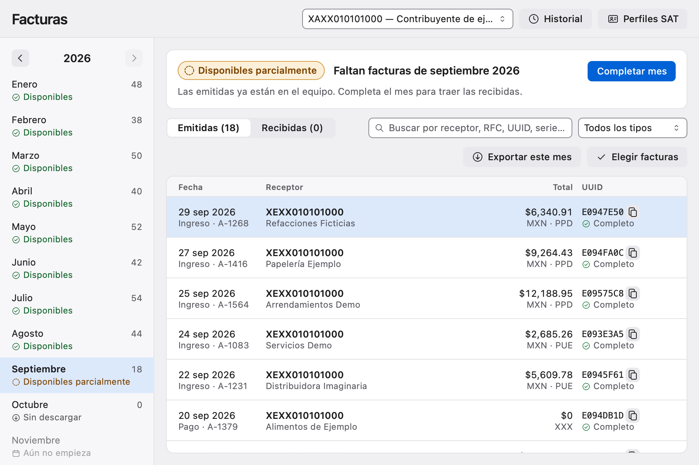
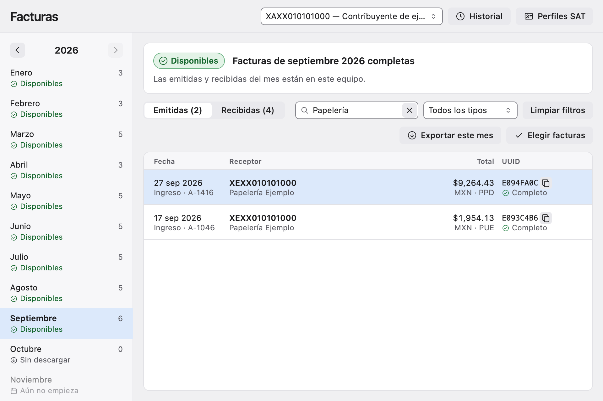

# Archivo Fiscal: manual de usuario

Archivo Fiscal es una aplicación de escritorio para macOS. Guarda en tu equipo
las facturas (CFDI) emitidas y recibidas de los contribuyentes que administras,
mes por mes. Las descarga del SAT con la e.firma de cada contribuyente, usando
el servicio de descarga masiva que el SAT ofrece. Todo se guarda localmente:
perfiles, facturas e historial. La e.firma se guarda cifrada y su contraseña
queda en el llavero de macOS.

La pantalla principal es **Facturas**: eliges un perfil y un mes, ves si las
facturas de ese mes ya están en el equipo y, si faltan, las descargas con un
botón. Después puedes buscarlas, ver su PDF y exportarlas.

Las imágenes de este manual usan solo datos ficticios: RFC genéricos del SAT
(`XAXX010101000`, `XEXX010101000`), nombres inventados como "Contribuyente de
ejemplo" o "Papelería Ejemplo", archivos `demo.cer` y `demo.key` y rutas bajo
`/Users/usuario/...`. Las imágenes marcadas como **Ilustración** son dibujos
simplificados de elementos de macOS (menu bar, notificaciones, Finder y
selector de archivos). Muestran los mismos textos que la app y el icono del
menu bar es el mismo dibujo, aunque su aspecto puede variar respecto de macOS.

La app muestra las fechas en formato legible, por ejemplo "3 sep 2026" o
"14 oct 2026, 09:00". La vigencia de la e.firma se muestra como AAAA-MM-DD.

Contenido:

1. [Primer uso](#1-primer-uso)
2. [Perfiles SAT y e.firma](#2-perfiles-sat-y-efirma)
3. [Facturas por mes](#3-facturas-por-mes)
4. [Descargar las facturas del mes](#4-descargar-las-facturas-del-mes)
5. [Estados del mes](#5-estados-del-mes)
6. [Buscar, filtrar y atajos de teclado](#6-buscar-filtrar-y-atajos-de-teclado)
7. [Ver el PDF de una factura](#7-ver-el-pdf-de-una-factura)
8. [Historial](#8-historial)
9. [Exportar facturas](#9-exportar-facturas)
10. [Respaldo y restauración](#10-respaldo-y-restauración)
11. [Menu bar](#11-menu-bar)
12. [Notificaciones de macOS](#12-notificaciones-de-macos)
13. [Mensajes frecuentes y cómo resolverlos](#13-mensajes-frecuentes-y-cómo-resolverlos)
14. [Apéndice: Diagnóstico](#apéndice-diagnóstico)

## 1. Primer uso

Para descargar facturas necesitas un perfil SAT con su e.firma registrada.

1. Abre Archivo Fiscal. Si todavía no tienes perfiles, **Facturas** muestra la
   guía **Empieza con un perfil fiscal**: "Archivo Fiscal guarda en este equipo
   las facturas emitidas y recibidas de cada RFC, mes por mes."
2. La guía tiene tres pasos. Cada uno indica si ya está hecho (con una marca)
   o pendiente, y el botón del siguiente paso aparece resaltado:

   | Paso | Botón | Qué hace |
   | --- | --- | --- |
   | Crea un perfil SAT con el RFC del contribuyente | Perfiles SAT | Abre Perfiles SAT ([sección 2](#2-perfiles-sat-y-efirma)). |
   | Registra la e.firma del perfil | Registrar e.firma… | Abre Perfiles SAT para registrar la e.firma ([Registrar la e.firma](#registrar-la-efirma)). |
   | Descarga las facturas de un mes | Ver facturas | Se hace en Facturas en cuanto tienes un perfil ([sección 4](#4-descargar-las-facturas-del-mes)). |

3. Con el perfil creado, **Facturas** muestra sus meses. Si el perfil aún no
   tiene e.firma lista, arriba de la franja del mes aparece "Registra la
   e.firma del perfil para descargar." y el botón de la franja dice
   **Registrar e.firma…**: te lleva a Perfiles SAT.
4. Con la e.firma lista, elige un mes y pulsa **Descargar facturas**. La app
   se encarga del resto, aunque cierres la ventana.

## 2. Perfiles SAT y e.firma

Un perfil SAT representa a un contribuyente: su RFC y un nombre descriptivo.
Para descargar facturas con un perfil, debe estar activo y tener su e.firma
registrada y vigente. Abre la pantalla con el botón **Perfiles SAT** de
Facturas, con **Ir > Perfiles SAT** o con ⌘2. **‹ Facturas** (o la tecla
Escape, o ⌘1) regresa a Facturas.

La pantalla tiene dos paneles: a la izquierda la lista de perfiles y a la
derecha el perfil seleccionado. Al abrirla queda seleccionado el primer perfil.
Puedes cambiar el ancho de los paneles arrastrando la línea que los separa.

### Crear o editar un perfil

1. Pulsa **Nuevo perfil**.
2. Escribe el **RFC** y un **Nombre descriptivo**, y pulsa **Guardar** en el
   pie del grupo **Perfil**. **Descartar** abandona los cambios. Los dos botones
   se habilitan cuando hay cambios.
3. Selecciona un perfil de la lista para editarlo. En edición solo cambia el
   nombre: el RFC aparece con un candado y la ayuda "El RFC identifica al perfil
   y no se puede cambiar."

Los avisos del formulario aparecen bajo su campo: "Ya existe un perfil con ese
RFC." (la app conserva lo que escribiste), "El RFC no es válido." e "Indica un
nombre para el perfil."

Si todavía no hay perfiles, el panel derecho dice "Aún no hay perfiles SAT" y
ofrece **Nuevo perfil**.

### Estado de la e.firma

Cada perfil de la lista muestra su RFC, su nombre, una etiqueta con el estado
de la e.firma y una línea de disponibilidad. La etiqueta usa color e icono, pero
el estado siempre está escrito.

| Etiqueta | Significado |
| --- | --- |
| Comprobando | La app está comprobando la e.firma guardada. |
| Sin e.firma | El perfil no tiene e.firma registrada. |
| e.firma lista | La e.firma está registrada y vigente. |
| e.firma vencida | La e.firma ya no es vigente; hay que reemplazarla. |
| e.firma aún no vigente | La e.firma todavía no entra en vigor. |
| e.firma incompleta en el llavero / e.firma dañada en el llavero | No se pudo leer la e.firma guardada; vuelve a registrarla. |
| Estado no disponible | No se pudo consultar el estado (por ejemplo, con el llavero bloqueado). Usa **Reintentar** en la fila, **Reintentar estado** en el grupo e.firma o la tecla R sobre la fila. |

La línea de disponibilidad dice "Disponible para descargas", "No disponible
para descargas" o, si el perfil está inactivo, "Inactivo: no disponible para
descargas". Si la e.firma tiene vigencia conocida, también aparece "Vigente
hasta AAAA-MM-DD".

En el panel derecho, el grupo **e.firma** repite la etiqueta y explica el
estado: "Lista para descargas · Vigente hasta 2026-11-05" o "Este perfil no
tiene e.firma registrada.", seguido de "La e.firma se guarda cifrada y su
contraseña queda en el llavero de macOS." o "Regístrala para poder descargar
facturas con este perfil."

### Aviso de vencimiento

Cuando a una e.firma lista le quedan 30 días o menos de vigencia, la fila del
perfil muestra junto a "Vigente hasta AAAA-MM-DD" la etiqueta de advertencia
"Vence en N días"; con un día completo dice "Vence en 1 día" y, cuando faltan
menos de 24 horas, "Vence hoy". El grupo **e.firma** del panel derecho repite
la etiqueta junto a "e.firma lista". En la imagen anterior, la e.firma de
XAXX010101000 vence en 21 días.

La e.firma sigue lista y se puede usar para descargar hasta esa fecha. Para no
quedarte sin ella, renuévala con el SAT y regístrala con **Reemplazar
e.firma…** (ver [Reemplazar la e.firma](#reemplazar-la-efirma)). Si la nueva
e.firma vence en más de 30 días, la etiqueta desaparece.

Además, la app avisa con la notificación **e.firma por vencer** cuando faltan
30 días y otra vez cuando faltan 7 (ver la [sección 12](#12-notificaciones-de-macos)).
Si la app encuentra una e.firma a 7 días o menos sin haber avisado antes, solo
envía el aviso de 7 días. La app revisa la vigencia al abrirse, cada 24 horas
mientras está abierta y cuando registras o reemplazas una e.firma. Cada aviso
llega una sola vez por e.firma; si la reemplazas, la nueva vuelve a avisar
cuando le toque. Las e.firmas vencidas o que no están listas no generan este
aviso: ya aparecen con su etiqueta y con la notificación **e.firma no
disponible**.

### Registrar la e.firma

1. Selecciona el perfil. Si tienes cambios sin guardar, primero guarda el
   perfil ("Guarda el perfil antes de gestionar su e.firma.").
2. En el grupo **e.firma**, pulsa **Registrar e.firma…**.
3. El diálogo **Registrar e.firma** muestra el RFC y el nombre del perfil, y la
   instrucción "Elige el certificado (.cer), la llave privada (.key) y escribe
   la contraseña de la llave." Pulsa **Elegir…** junto a **Certificado (.cer)**
   y junto a **Llave privada (.key)**. Cada botón abre el selector de archivos
   de macOS. En el campo solo se muestra el nombre del archivo, nunca su ruta;
   sin archivo dice "Ningún archivo".
4. Escribe la **Contraseña** ("Se guarda en el llavero de macOS.").
5. **Registrar** se habilita solo cuando elegiste el certificado, la llave y
   escribiste la contraseña. Mientras tanto, el pie del diálogo dice qué falta:
   "Elige el certificado (.cer).", "Elige la llave privada (.key)." o "Escribe
   la contraseña de la llave privada." Pulsa **Registrar** (o Enter en el campo
   de contraseña).
6. Mientras se valida aparece "Validando e.firma…" y los controles se
   deshabilitan. Al terminar aparece "e.firma registrada." con "`<RFC>` ya está
   disponible para descargas." y el botón **Cerrar**.

Si la validación falla, el mensaje aparece bajo el campo que lo causó (por
ejemplo, la contraseña) y el foco va a ese campo. Por seguridad, la app olvida
la selección: los campos vuelven a "Ningún archivo", la contraseña se vacía y
aparece "Vuelve a elegir los archivos y escribe la contraseña."

El campo de contraseña se vacía al enviar, al cancelar, al cerrar el diálogo,
al cambiar de perfil, al salir de la pantalla y al ocultar la ventana.

### Reemplazar la e.firma

Si el perfil ya tiene e.firma, el botón dice **Reemplazar e.firma…**; es el
botón principal cuando la e.firma está vencida, aún no es vigente o no se pudo
leer. Antes de capturar los archivos, la app pide confirmación con "¿Reemplazar
la e.firma de `<RFC>`?" y "La e.firma registrada se reemplazará solo si la
nueva se valida. Si falla, la actual sigue registrada sin cambios." Pulsa
**Continuar** y sigue los mismos pasos que en el registro; el diálogo se llama
**Reemplazar e.firma** y el botón final dice **Reemplazar**. Si el reemplazo
falla, el mensaje termina con "La e.firma anterior sigue registrada sin
cambios." y la lista vuelve a mostrar el estado real de la e.firma anterior.

Los errores al registrar o reemplazar están en la [sección 13](#13-mensajes-frecuentes-y-cómo-resolverlos).

## 3. Facturas por mes

**Facturas** es la pantalla principal. Ábrela con **Ir > Facturas**, con ⌘1 o
con **Ver facturas** en el menu bar.

![Pantalla Facturas del perfil XAXX010101000 — Contribuyente de ejemplo: a la izquierda el año 2026 con la lista de meses de enero a septiembre en Disponibles con su número de facturas, octubre Sin descargar y noviembre Aún no empieza; septiembre seleccionado; a la derecha la franja Disponibles con Facturas de septiembre 2026 completas, las pestañas Emitidas (14) y Recibidas (33), la búsqueda, el filtro Todos los tipos, Exportar este mes, Elegir facturas y la lista con Fecha, Receptor, Total y UUID](img/16-facturas-mes.png)

La pantalla tiene estas partes:

- Encabezado: el título **Facturas**, el selector de perfil (por ejemplo
  "XAXX010101000 — Contribuyente de ejemplo") y los botones **Historial** (⌘3)
  y **Perfiles SAT** (⌘2). Al cambiar de perfil, la pantalla muestra los meses
  de ese perfil.
- Lista de meses, a la izquierda: arriba el año, con los botones **Año
  anterior** y **Año siguiente** (flechas `‹` y `›`); debajo los doce meses de
  ese año. Cada mes muestra su nombre, el número de facturas que ya están en el
  equipo y su estado escrito con icono (ver la [sección 5](#5-estados-del-mes)).
  Los meses que aún no empiezan aparecen atenuados con "Aún no empieza" y no se
  pueden elegir. Se pueden consultar los meses de los últimos 6 años.
- Franja del mes: el estado del mes elegido, un titular, una explicación y,
  cuando aplica, una sola acción (ver la [sección 4](#4-descargar-las-facturas-del-mes)).
- Pestañas **Emitidas** y **Recibidas**, cada una con su número de facturas, por
  ejemplo "Emitidas (14)" y "Recibidas (33)".
- Búsqueda y filtro de tipo (ver la [sección 6](#6-buscar-filtrar-y-atajos-de-teclado))
  y los botones **Exportar este mes** y **Elegir facturas** (ver la
  [sección 9](#9-exportar-facturas)).
- Lista de facturas del mes y la pestaña elegidos, de la más reciente a la
  más antigua.

Al abrir la app, Facturas muestra el mes anterior al actual (el último mes
completo). Mientras la app esté abierta, recuerda el último mes que viste de
cada perfil.

### La lista de facturas

Cada factura muestra solo la contraparte: en Emitidas la columna dice
**Receptor**; en Recibidas, **Emisor**. Las columnas son:

- **Fecha**: fecha del CFDI y, debajo, el tipo (Ingreso, Egreso, Traslado,
  Nómina o Pago) con la serie y el folio, por ejemplo "Ingreso · A-1268".
- **Receptor** o **Emisor**: RFC y nombre de la contraparte.
- **Total**: el importe y, debajo, la moneda y el método de pago, por ejemplo
  "MXN · PPD".
- **UUID**: los primeros 8 caracteres del folio fiscal, con un botón para
  copiarlo completo, y el estado de lectura: Completo, Parcial (hay datos o
  complementos que la app no representa), Versión no soportada o Ilegible.

Mientras la lista carga, o si el mes no tiene facturas, la lista lo indica:
"Aún no hay facturas de este mes en el equipo.", "No hay facturas emitidas en
este mes." o "No hay facturas recibidas en este mes.". Mientras se descargan,
dice "Las facturas aparecerán aquí conforme se descarguen.". Si la app no
puede leerlas, dice "No se pudieron leer las facturas de este mes." con
**Reintentar**.

### Ventanas angostas

Si la ventana mide menos de unos 760 puntos de ancho, la lista de meses se
convierte en un selector: a la izquierda el año con **Año anterior** y **Año
siguiente**, y a la derecha un menú con los meses de ese año, cada uno con su
estado y su número de facturas (por ejemplo "septiembre 2026, Disponibles, 47
facturas"). La búsqueda y el filtro pasan a una fila propia bajo las pestañas,
y el botón **Limpiar filtros** no aparece (usa Escape en la búsqueda, o el
botón **Limpiar filtros** que aparece cuando ninguna factura coincide).

## 4. Descargar las facturas del mes

La franja del mes ofrece una sola acción a la vez. El botón cambia según lo
que falte:

| Botón | Cuándo aparece | Qué hace |
| --- | --- | --- |
| **Descargar facturas** | El mes no tiene facturas en el equipo ("Sin descargar"). | Pide al SAT las emitidas y las recibidas de todo el mes. |
| **Actualizar mes** | El mes está en curso y ya tiene facturas hasta cierta hora. | Pide las facturas desde esa hora hasta ahora. |
| **Completar mes** | El mes ya terminó y faltan facturas ("Disponibles parcialmente"). | Pide solo lo que falta: una dirección, o los días que faltan. |
| **Reintentar** | Algo falló ("Requiere atención") y se puede volver a pedir. | Vuelve a pedir lo que no se obtuvo. |
| **Registrar e.firma…** | El perfil no tiene la e.firma lista. | Abre Perfiles SAT para registrar o reemplazar la e.firma. |
| **Ver detalles técnicos** | Algo falló y no conviene volver a pedirlo. | Abre Diagnóstico (ver el [apéndice](#apéndice-diagnóstico)). |

También puedes usar ⌘R (o **Facturas** en el menú de la app) para la acción de
la franja. Si el botón está deshabilitado, debajo se explica por qué, por
ejemplo "Ya se están preparando las facturas de este mes." o "La descarga se
está iniciando.".

Al pulsar la acción, el mes pasa a **Preparando**. Descargar un mes puede
tardar de unos minutos a varias horas: primero el SAT prepara las facturas y
después la app las descarga y las organiza. La franja lo dice con "Esperando a
que el SAT prepare las facturas" o "Descargando y organizando las facturas" y
la nota "Puedes cerrar la ventana; te avisaremos.". La app sigue trabajando con
la ventana cerrada mientras esté abierta (ver la [sección 11](#11-menu-bar)), y
te avisa con una notificación por cada dirección (ver la [sección
12](#12-notificaciones-de-macos)). Las facturas aparecen en la lista conforme
se descargan.

El mes en curso no se puede completar el mismo día: cuando ya tiene las
facturas de hoy, la franja dice "El mes sigue en curso. Mañana podrás
actualizarlo para traer las facturas nuevas.".

### Confirmar por dirección

Si ya se intentó descargar ese periodo en una dirección y no terminó bien (por
ejemplo, el SAT no aceptó prepararlo o no se sabe si recibió la petición), la
app pide confirmación antes de pedirlo otra vez. Pregunta por cada dirección,
una a la vez:

- Título: "¿Descargar de nuevo las recibidas de septiembre 2026?" (o las
  emitidas).
- Texto: "Ya se intentó descargar este periodo y no terminó bien. Puedes
  pedirlo de nuevo; el SAT podría rechazar una petición igual. Las emitidas no
  cambian."
- **Omitir recibidas** (u **Omitir emitidas**) es el botón por omisión; Enter o
  Escape lo eligen. No pide esa dirección; si omites alguna, la franja dice,
  por ejemplo, "Se omitieron las recibidas.".
- **Descargar de nuevo** la pide otra vez.

### Avisos de la franja

Si algo cambia mientras pides la descarga, la franja lo dice en un aviso:
"El estado del mes cambió; revisa la franja antes de continuar.", "El perfil
ya no está disponible.", "Este mes aún no empieza." o "No se pudo iniciar la
descarga. Inténtalo de nuevo.". No se pidió nada al SAT; revisa la franja y
vuelve a pulsar la acción si sigue disponible.

## 5. Estados del mes

Cada mes tiene uno de estos cinco estados. Aparece escrito, con icono, en la
lista de meses y en la franja:

| Estado | Qué significa | Acción de la franja |
| --- | --- | --- |
| Sin descargar | Las facturas de ese mes no están en el equipo. | **Descargar facturas** |
| Preparando | El SAT está preparando las facturas o la app las está descargando. | Ninguna (el botón aparece deshabilitado) |
| Disponibles | Las emitidas y las recibidas del mes están en el equipo. | Ninguna |
| Disponibles parcialmente | Hay facturas, pero faltan una dirección o algunos días. | **Completar mes** o, en el mes en curso, **Actualizar mes** |
| Requiere atención | No se pudieron obtener todas las facturas. | **Reintentar** o **Ver detalles técnicos** |

Además, un mes que todavía no empieza dice "Aún no empieza"; mientras la app
lee el estado, "Cargando"; y si no lo puede leer, "No disponible", con el
titular "No se pudo leer el estado de septiembre 2026", "Vuelve a intentarlo
en un momento." y **Reintentar**.

### Sin descargar

La franja dice "Las facturas de septiembre 2026 no están en este equipo" y
"Descarga del SAT las emitidas y recibidas del mes. Puede tardar de unos
minutos a varias horas.", con **Descargar facturas**.

### Preparando

La franja dice "Preparando las facturas de septiembre 2026" con la etapa y la
nota "Puedes cerrar la ventana; te avisaremos.". El botón **Descargar
facturas** queda deshabilitado con "Ya se están preparando las facturas de
este mes.".

### Disponibles

Para un mes que ya terminó, la franja dice "Facturas de septiembre 2026
completas" y "Las emitidas y recibidas del mes están en este equipo." (ver la
imagen de la [sección 3](#3-facturas-por-mes)). Para el mes en curso dice
"Facturas disponibles hasta el 15 de octubre, 14:05" y "El mes sigue en curso.
Mañana podrás actualizarlo para traer las facturas nuevas.".

### Disponibles parcialmente

Faltan facturas. En un mes que ya terminó, la franja dice "Faltan facturas de
septiembre 2026" y explica qué falta:

- "Las emitidas ya están en el equipo. Completa el mes para traer las
  recibidas." (o al revés);
- "Hay facturas hasta el 20 de septiembre, 18:00. Completa el mes para traer
  las del resto de septiembre.";
- o "Completa el mes para traer las facturas que faltan.".

En el mes en curso dice "Facturas disponibles hasta el …" y "El mes sigue en
curso. Actualiza para traer las facturas desde esa hora hasta ahora.", con
**Actualizar mes**.

### Requiere atención

La franja dice "No se pudieron obtener todas las facturas de septiembre 2026",
la causa y "Reintenta; si el problema sigue, revisa los detalles técnicos.",
con **Reintentar** y el enlace **Ver detalles técnicos**. Las facturas que ya
se descargaron siguen visibles en la lista.

Causas posibles (cada una nombra las emitidas o las recibidas):

| Causa | Qué hacer |
| --- | --- |
| El SAT reportó un error al preparar las recibidas. | Pulsa **Reintentar**. |
| El SAT no aceptó preparar las recibidas. | Pulsa **Reintentar**; si se repite, revisa **Ver detalles técnicos**. |
| El SAT rechazó la petición de las recibidas. | Pulsa **Reintentar**; la app pedirá confirmación. |
| No se sabe si el SAT recibió la petición de las recibidas. | Pulsa **Reintentar**; la app pedirá confirmación. |
| El SAT dejó de ofrecer las recibidas antes de descargarlas. | Pulsa **Reintentar** para pedirlas de nuevo. |
| No se pudo descargar una parte de las recibidas. | Pulsa **Reintentar**. |
| Una parte de las recibidas ya no está disponible en el SAT. | Pulsa **Reintentar** para pedirla de nuevo. |
| Falta en este equipo un archivo de las recibidas. | El archivo se movió o se borró fuera de la app; pulsa **Reintentar**. |
| Un archivo de las recibidas que entregó el SAT está dañado. | Pulsa **Reintentar**. |
| No se pudieron leer las recibidas guardadas en este equipo. | Pulsa **Reintentar**; si se repite, revisa **Ver detalles técnicos**. |
| Las recibidas descargadas aún no se han organizado. | Pulsa **Reintentar**. |
| El SAT ya no permite volver a pedir las recibidas de este mes. | No se puede volver a pedir; la franja ofrece **Ver detalles técnicos**. |
| El SAT indica que ya hay una descarga igual de las recibidas en curso. | Espera; la franja ofrece **Ver detalles técnicos**. |

**Ver detalles técnicos** abre Diagnóstico con la información técnica de ese
mes (ver el [apéndice](#apéndice-diagnóstico)). No hace falta usarlo para el
trabajo diario.

## 6. Buscar, filtrar y atajos de teclado

### Buscar

Escribe en la búsqueda o pulsa ⌘F para ir a ella. Encuentra por nombre de la
contraparte, RFC, UUID, serie o folio, sin importar mayúsculas ni acentos; la
lista se actualiza al dejar de escribir. La búsqueda dice "Buscar por receptor,
RFC, UUID, serie o folio" en Emitidas y "Buscar por emisor, RFC, UUID, serie o
folio" en Recibidas. La búsqueda aplica a las dos pestañas: sus números
cambian para mostrar cuántas facturas coinciden en cada una.

Para borrar la búsqueda, pulsa la `x` del campo (**Borrar búsqueda**) o Escape
con el foco en el campo. La flecha abajo pasa de la búsqueda a la lista.

### Filtrar por tipo

El filtro **Todos los tipos** deja solo Ingreso, Egreso, Traslado, Nómina o
Pago. **Limpiar filtros** quita la búsqueda y el filtro de tipo. Si nada
coincide, la lista dice "Ninguna factura coincide con la búsqueda." con
**Limpiar filtros**.

### Atajos de teclado

Los atajos también están en el menú de la app (**Facturas** e **Ir**). No
actúan con un diálogo abierto ni mientras escribes en un campo de texto.

| Atajo | Qué hace |
| --- | --- |
| ⌘1 | Ir a Facturas. |
| ⌘2 | Ir a Perfiles SAT. |
| ⌘3 | Ir a Historial. |
| ⌘4 | Ir a Respaldo. |
| ⌘F | Ir a la búsqueda de Facturas. |
| ⌘R | Ejecutar la acción de la franja del mes (**Descargar facturas**, **Completar mes**, **Reintentar**…). |
| ⌘↑ / ⌘↓ | Mes anterior / mes siguiente. Cruza de año: ⌘↑ en enero va a diciembre del año anterior. |
| ↑ / ↓ en la lista de meses | Mes anterior / mes siguiente. |
| **Año anterior** / **Año siguiente** | Cambia de año y conserva el mes; si ese mes aún no empieza, va al mes más reciente. |
| ↑ / ↓ en la lista de facturas | Mueve la selección. |
| Enter o doble clic | Abre el PDF de la factura seleccionada. |
| ⌘C en la lista de facturas | Copia el UUID completo de la factura seleccionada. |
| Escape | Borra la búsqueda (con el foco en ella), cierra el PDF o sale del modo de selección. |

Con Tab recorres el perfil, los meses, la franja, las pestañas, la búsqueda,
el filtro, los botones de exportar y la lista.

## 7. Ver el PDF de una factura

Para ver una factura, selecciónala y pulsa Enter, o haz doble clic sobre ella.
La app genera en tu equipo un PDF con los datos del XML: emisor, receptor,
conceptos, impuestos, totales, el timbre fiscal y el código QR de verificación
del SAT. Mientras lo prepara, la pantalla dice "Generando el PDF…"; la
siguiente vez que abras la misma factura aparece al instante.

El PDF es una visualización generada en tu equipo: no es la representación
impresa que emite el contribuyente ni valida el sello, la vigencia o la
cancelación. El comprobante fiscal sigue siendo el XML. El PDF lo indica con
una leyenda.

En la vista del PDF:

- **Guardar PDF…** abre el diálogo de macOS para elegir dónde guardar una
  copia; el nombre sugerido es `CFDI-<serie y folio>-<inicio del UUID>.pdf`,
  sin RFC ni nombres. Al terminar, la app dice "PDF guardado como “…”.". Si no
  se pudo guardar, lo dice ahí mismo y nada más cambia.
- **Abrir en Vista Previa** abre el PDF en la app Vista Previa de macOS (para
  imprimirlo, por ejemplo). Si no se pudo abrir, la app muestra el motivo.
- Si el PDF tiene varias páginas, desplázate hacia abajo; la esquina inferior
  indica "Página N de M". ⌘+ y ⌘− cambian el zoom y ⌘0 lo ajusta al ancho.
- Escape (o **‹ Facturas**) regresa a la lista con la misma factura
  seleccionada.

Si la app no puede generar el PDF, lo dice en lugar del documento:

| Mensaje | Qué hacer |
| --- | --- |
| El ZIP de esta factura no está disponible. | "Se movió o se borró fuera de la app. Revisa la carpeta de archivos descargados e intenta de nuevo." Pulsa **Reintentar**. |
| La app no representa esta versión de CFDI. / No se pudo leer el XML de esta factura. | "No se generó el PDF. El XML sigue en el archivo descargado del SAT." |
| No se pudo generar el PDF. / Se canceló la generación del PDF. | Pulsa **Reintentar**. |
| No se pudo mostrar el PDF. | Pulsa **Reintentar** o usa **Abrir en Vista Previa**. |

## 8. Historial

**Historial** muestra las descargas del perfil elegido en Facturas, de la más
reciente a la más antigua: una fila por cada vez que pediste un mes. Ábrelo con
el botón **Historial** de Facturas, con **Ir > Historial** o con ⌘3. **‹
Facturas** (o Escape) regresa a la pantalla de la que venías.

Cada fila muestra el mes (por ejemplo "Septiembre 2026"), la fecha de la
descarga ("Descarga del 3 oct 2026, 11:12"), el resultado y cuántas facturas
se obtuvieron ("18 emitidas, 28 recibidas", "Solo emitidas: 12" o "El SAT no
tenía facturas de este mes").

| Resultado | Qué significa |
| --- | --- |
| Completa | Se obtuvieron todas las facturas pedidas. |
| En preparación | El SAT todavía las está preparando o la app las está descargando. |
| Requiere atención | No se pudieron obtener todas; aparece **Reintentar**. |
| Sin facturas en el SAT | El SAT no tenía facturas de ese periodo. |
| Cubierta por otra descarga | "Una descarga posterior obtuvo estas facturas". |
| Eliminada | "Esta descarga se eliminó de este equipo". |
| Descarga anterior | Hecha con una versión anterior de la app ("Hecha con una versión anterior" o "Hecha con una versión anterior, con filtros"). Solo tiene detalles técnicos. |

Si parte de una descarga se eliminó, la fila agrega "Parte de esta descarga se
eliminó".

Acciones de cada fila:

- **Ver facturas** abre ese mes en Facturas.
- **Reintentar** abre ese mes en Facturas y vuelve a pedir lo que falta, igual
  que **Reintentar** en la franja.
- **Ver detalles técnicos** abre Diagnóstico. Si la descarga incluye emitidas y
  recibidas, el botón dice **Ver detalles técnicos…** y primero pregunta cuál:
  **Emitidas** o **Recibidas**.

Si el perfil no tiene descargas, Historial dice "Aún no hay descargas de este
perfil" y "Las descargas se inician desde Facturas, por perfil y mes.", con
**Ir a Facturas**. Si no puede leerlo, dice "No se pudo leer el historial" con
**Reintentar**.

## 9. Exportar facturas

Desde **Facturas** puedes guardar en un solo archivo ZIP las facturas que ya
están en tu equipo, para entregarlas o guardarlas donde tú quieras. La app no
se conecta al SAT para exportar: usa solo lo que ya descargó.

Hay tres formas de elegir qué exportar:

- **Este mes**: pulsa **Exportar este mes**. Se exportan las facturas del mes
  que estás viendo.
- **Varios meses**: en el diálogo, elige **Varios meses** e indica **Desde** y
  **Hasta**. Puede ser el mismo mes en los dos. El rango no puede incluir meses
  que todavía no empiezan ni meses fuera de los que se pueden consultar en
  Facturas (los últimos 6 años), y el mes inicial no puede ser posterior al
  final; si pasa, el diálogo lo dice debajo del rango y no deja exportar.
- **Elegidas**: pulsa **Elegir facturas**. Cada fila muestra una casilla;
  márcala con un clic o, con la fila seleccionada, con la barra espaciadora.
  Arriba se ve cuántas llevas ("3 facturas elegidas"). Lo elegido se conserva
  al cambiar entre Emitidas y Recibidas, al buscar o filtrar y cuando la lista
  se actualiza, pero se borra al cambiar de perfil. **Quitar selección**
  desmarca todo; **Listo** o Escape salen del modo de selección. Pulsa
  **Exportar elegidas…** para abrir el diálogo.

### El diálogo Exportar facturas

El diálogo siempre muestra este aviso:

> El archivo que vas a crear contiene tus facturas completas y no está
> protegido con contraseña. Cualquier persona que lo abra podrá verlas. Si lo
> guardas en iCloud Drive, Dropbox o una carpeta compartida, se copiará fuera
> de este equipo. Guárdalo en un lugar de confianza y bórralo cuando ya no lo
> necesites.

Debajo eliges:

- **Qué exportar**: **Este mes**, **Varios meses** o **Elegidas (N)**.
- **Facturas** (solo para un mes o varios): **Emitidas**, **Recibidas** o
  **Ambas**. Por omisión, la pestaña que estabas viendo. Con facturas elegidas
  no hay que elegir: se exporta exactamente lo que marcaste.
- **Incluir el PDF de cada factura**: agrega junto a cada XML el mismo PDF que
  ves al abrir la factura.
- Cuántas facturas se exportarán ("Se exportarán 14 facturas."). Si alguna no
  está en tu equipo, o un mes tiene descargas pendientes o incompletas, el
  diálogo lo avisa antes de exportar. Si no hay ninguna, dice "No hay facturas
  para exportar" y **Exportar** queda deshabilitado; no se crea un archivo
  vacío.
- **Guardar en**: pulsa **Elegir carpeta…** para elegir la carpeta con el
  diálogo de macOS. No puede ser una carpeta dentro de los datos de Archivo
  Fiscal.
- **Nombre del archivo**: la app sugiere uno sin RFC ni nombres, por ejemplo
  `Archivo-Fiscal-2026-09.zip`, `Archivo-Fiscal-2026-08_2026-09.zip` para
  varios meses o `Archivo-Fiscal-seleccion-2026-10-26.zip` para facturas
  elegidas. Puedes cambiarlo; la app quita los caracteres que macOS no admite y
  agrega `.zip` si falta.

**Exportar** se habilita cuando hay facturas y una carpeta elegida. **Cancelar**
o Escape cierran el diálogo sin crear nada.

### Mientras se exporta

El diálogo muestra la etapa ("Agregando facturas…", "Creando los PDF…",
"Terminando el archivo…") con una barra y el conteo de facturas exportadas.
**Cancelar exportación** (o Escape) detiene el trabajo: no queda ningún archivo
a medias en la carpeta. Solo corre una exportación a la vez.

### Si el nombre ya existe

La app nunca reemplaza un archivo. Si en la carpeta ya hay uno con ese nombre,
el diálogo dice "Ya existe un archivo con ese nombre en la carpeta. Escribe otro
nombre.", con el foco en **Nombre del archivo**. Escribe otro nombre y pulsa
**Guardar con este nombre** (no se vuelve a preparar el archivo) o pulsa
**Cancelar exportación** para descartarlo.

### Resultado y contenido del ZIP

Al terminar, el diálogo dice "Exportación terminada" con el número de facturas
exportadas (y de PDF, si los pediste) y el nombre del archivo creado. Si
algunas facturas no se incluyeron o salieron sin PDF, lo indica con su conteo.
Si no se pudo leer ninguna factura, dice "No se exportó ninguna factura" y el
ZIP solo contiene `omitidas.txt`.

Dentro del ZIP:

- `emitidas/AAAA-MM/<UUID>.xml` y `recibidas/AAAA-MM/<UUID>.xml`: el XML
  original de cada factura, sin cambios, agrupado por el mes que ves en
  Facturas. Con PDF, `<UUID>.pdf` va junto a su XML. El PDF es una
  visualización generada en tu equipo, igual que al abrir la factura; el
  comprobante fiscal es el XML.
- `omitidas.txt`, solo si algo no se exportó completo: una línea por factura
  con su UUID y el motivo ("no disponible en este equipo", "ilegible", "cambió
  desde que se indexó", "ya no disponible" o "sin PDF" cuando el XML sí se
  incluyó), y una línea por mes con descargas pendientes o cobertura
  incompleta. No incluye RFC, nombres ni rutas.

Una factura cuyo archivo descargado del SAT falta en tu equipo o todavía se
está descargando no se exporta y aparece en `omitidas.txt`. Si acabas de
descargar el mes, espera a que termine y exporta de nuevo.

Con el teclado: Tab recorre el diálogo en orden (qué exportar, facturas a
exportar, PDF, carpeta, nombre, **Cancelar** y **Exportar**); las flechas
cambian de opción en los selectores; Escape cierra o cancela según el momento.

## 10. Respaldo y restauración

Archivo Fiscal puede guardar una copia cifrada de tus datos (perfiles,
descargas, historial y archivos descargados del SAT) en una carpeta que tú
eliges, por ejemplo una carpeta de iCloud Drive o de Dropbox. La app solo copia
el respaldo a esa carpeta; el servicio de nube, si la sincroniza, se encarga de
lo demás por su cuenta. Por eso la app dice "copiado a la carpeta" y no puede
confirmar qué hizo tu servicio de nube con el archivo.

Abre la pantalla con **Ir > Respaldo** o con ⌘4. El botón de regreso del
encabezado lleva el nombre de la pantalla de la que venías (por ejemplo
**‹ Facturas**); Escape hace lo mismo.

### Elegir la carpeta

En **Carpeta**, pulsa **Elegir carpeta…** y elige la carpeta en el selector de
macOS, por ejemplo `/Users/usuario/Library/Mobile Documents/com~apple~CloudDocs/Respaldos`
o `/Users/usuario/Dropbox/Respaldos`. La pantalla muestra solo el nombre de la
carpeta ("Las copias se guardan en «Respaldos».") y la app confirma con
"Carpeta del respaldo guardada.". Puedes cambiarla después con **Cambiar
carpeta…**.

Elige una carpeta en un disco de tu Mac o en un disco externo con formato de
macOS. Un disco con formato exFAT no es compatible.

### Contraseña y clave de recuperación

Los respaldos siempre se cifran. En **Contraseña**, pulsa **Crear
contraseña…**, escríbela dos veces y pulsa **Crear contraseña**. La contraseña
debe tener al menos 12 caracteres. Archivo Fiscal no guarda tu contraseña en
texto: la protege en el llavero de macOS de este equipo.

Al crearla, la app muestra **Guarda tu clave de recuperación**. Con esa clave
puedes abrir tus respaldos si olvidas la contraseña:

- No se volverá a mostrar después de que confirmes que la guardaste. Este
  diálogo no se cierra con Escape: cuando la hayas guardado, pulsa **Ya la
  guardé**.
- **Copiar** la deja en el portapapeles de este equipo durante 90 segundos;
  después se borra y no pasa a tus otros dispositivos.
- **Imprimir…** abre el panel de impresión de macOS. Ese panel también permite
  **Guardar como PDF** o abrirla en Vista Previa, y la cola de impresión puede
  conservar una copia. Archivo Fiscal no la guarda. Lo más seguro es anotarla o
  imprimirla y guardar el papel en un lugar seguro.
- Si sales de Respaldo antes de pulsar **Ya la guardé** (por ejemplo, desde el
  menu bar o una notificación), la clave no se pierde: la ventana muestra
  **Guarda tu clave de recuperación** y **Ver la clave** vuelve a abrir el
  diálogo.
- Si pierdes la contraseña y también la clave de recuperación, no podrás
  abrir tus respaldos.

### Cambiar la contraseña

Pulsa **Cambiar contraseña…**. Elige si te identificas con la **Contraseña
anterior** o con la **Clave de recuperación**, escríbela y después escribe dos
veces la contraseña nueva, de al menos 12 caracteres. La clave de recuperación
**no cambia**: la app confirma con "Contraseña cambiada. Tu clave de
recuperación sigue siendo la misma.". Las copias anteriores se abren con la
contraseña anterior o con la clave; las nuevas, con la contraseña nueva o con
la clave.

### Respaldo diario

Activa **Respaldar una vez al día mientras la aplicación esté abierta** para
que la app haga un respaldo cada día por su cuenta. Mientras falte algo, la
pantalla lo indica: "El respaldo diario empezará cuando elijas una carpeta." o
"El respaldo diario empezará cuando crees una contraseña.". El resultado del
último respaldo, manual o diario, se muestra en la pantalla al volver a
abrirla.

### Respaldar ahora

Con la carpeta y la contraseña listas, pulsa **Respaldar ahora**. Mientras
trabaja, la pantalla muestra el paso ("Preparando la copia de tus datos…",
"Cifrando y copiando a la carpeta…", "Terminando la copia…", "Depurando
copias anteriores…") y una barra de progreso. Solo corre un respaldo a la vez.

Al terminar verás uno de estos avisos:

- **Respaldo copiado a la carpeta**, con la fecha y el tamaño: la copia
  cifrada quedó en la carpeta elegida.
- **Respaldo copiado a la carpeta, con avisos**: la copia es válida, pero
  debajo se explica algo que conviene revisar, por ejemplo "2 archivos del SAT
  ya no estaban en este equipo y no se incluyeron." o "La copia es válida, pero
  algunas copias anteriores requieren revisión manual.".
- **No se creó el respaldo**, con la causa (ver [Respaldo y
  restauración](#respaldo-y-restauración) en Mensajes frecuentes). Tus datos
  no cambian.

La app conserva las últimas 5 copias y borra las anteriores que ella misma
creó.

### Copias que hay que borrar a mano

Si una copia anterior no está descargada en este equipo (por ejemplo, porque
usaste **Quitar descarga** en iCloud Drive) y la app no tiene registro de
ella, no la borra. En ese caso aparece **Revisa la carpeta del respaldo** con
el texto "Hay 2 copias anteriores que no están descargadas en este equipo y
Archivo Fiscal no puede confirmar que sean suyas, así que no se borraron. Si
ya no las necesitas, bórralas a mano desde la carpeta.". Abre la carpeta en
Finder y borra las copias que ya no necesites.

### Restaurar un respaldo

Restaurar **sustituye** los datos de este equipo por los del respaldo; no los
combina. Puedes restaurar en la misma Mac o en otra.

1. En **Restaurar**, pulsa **Restaurar un respaldo…** y luego **Elegir
   archivo…**. El selector se abre en la carpeta del respaldo, si ya la
   elegiste. Elige el archivo `.afbak` del respaldo, por ejemplo en
   `/Users/usuario/Dropbox/Respaldos`.
2. Escribe la contraseña o la clave de recuperación de ese respaldo y pulsa
   **Verificar respaldo**. La app revisa todo el archivo antes de tocar nada;
   si está en la nube, puede tardar mientras se descarga. Puedes pulsar
   **Cancelar verificación** (o Escape) en cualquier momento.
3. Revisa el resumen: **Fecha del respaldo**, **Identificador**, **Contenido**
   (por ejemplo "2 perfiles, 5 descargas y 1 archivo del SAT.") y la versión
   con la que se creó. Si al hacer el respaldo ya faltaban archivos, el
   contenido lo agrega, por ejemplo "1 archivo del SAT ya faltaba cuando se
   hizo el respaldo.". Si no es el respaldo que buscas, pulsa **Descartar**.
4. Pulsa **Restaurar y reiniciar…** y confirma con **Restaurar y reiniciar**.
   La app se cierra y debería abrirse sola para aplicar la restauración.

Si la app no se abre sola, ábrela de nuevo: la restauración se aplica en cuanto
la abras. Si al pulsar Restaurar y reiniciar la app avisa "La aplicación se
cerrará y no podrá abrirse sola.", ábrela tú cuando se cierre. Al abrirse
muestra arriba de la ventana **Restauración aplicada**, con la fecha del
respaldo; pulsa **Entendido** para cerrar el aviso. Si el respaldo preparado
cambió o no se pudo completar la restauración, el aviso dice **Restauración
descartada** o **Restauración revertida** y tus datos actuales no se
modifican.

La e.firma **no** se restaura. Después de restaurar, registra de nuevo la
e.firma de cada perfil en Perfiles SAT (ver [Registrar la
e.firma](#registrar-la-efirma)); hasta entonces la app no se comunica con el
SAT para ese perfil. La configuración del respaldo de este equipo (carpeta,
contraseña y respaldo diario) tampoco cambia.

### Datos anteriores a una restauración

Al restaurar, tus datos anteriores no se borran: se guardan aparte en carpetas
`pre-restauracion-<fecha>`. Mientras existan, la ventana muestra el aviso
**Hay datos anteriores a una restauración** y las e.firmas anteriores se
conservan en el llavero de macOS. El botón **Revisar en Respaldo** del aviso
abre la pantalla Respaldo.

Cuando ya no los necesites, pulsa **Descartar datos anteriores…** en Respaldo y
confirma con **Descartar**. No se puede deshacer. Solo se borran las carpetas
que creó Archivo Fiscal; cualquier otra carpeta con un nombre parecido, o que
sea un enlace, queda intacta y la app te avisa para que la revises a mano.
Después se limpian del llavero las e.firmas anteriores.

## 11. Menu bar

La app pone un icono en la barra de menús de macOS. Cerrar la ventana solo la
oculta: la app y el monitoreo siguen activos, y las descargas en curso
continúan. Haz clic en el icono para abrir su menú; el icono también indica el
estado de la app (ver [El icono y su estado](#el-icono-y-su-estado)).

| Opción | Para qué sirve |
| --- | --- |
| Mostrar ventana | Muestra y trae al frente la ventana principal. |
| Ver facturas | Muestra la ventana en Facturas. |
| Monitoreo activo / Monitoreo en pausa / Trabajando: pidiendo facturas al SAT… / Trabajando: consultando al SAT… / Trabajando: descargando facturas… | Línea informativa con lo que hace el monitoreo, es decir, el trabajo con el SAT en segundo plano. |
| Pendientes: N | Acciones guardadas durante una pausa; solo aparece si hay alguna. |
| Pausar monitoreo / Reanudar monitoreo | Detiene o reanuda el trabajo con el SAT. La pausa se recuerda al volver a abrir la app. |
| Abrir al iniciar sesión | Abre la app al iniciar sesión en macOS, sin mostrar la ventana. |
| Estado en macOS: … | Lo que macOS reporta para ese inicio automático: habilitado, deshabilitado, pendiente de aprobación, rechazado o no disponible. Si está pendiente o rechazado aparece **Abrir ajustes de inicio de sesión…** |
| Notificaciones: … | Permiso de notificaciones: sin permiso solicitado, permitidas, deshabilitadas o no disponibles. Según el caso aparecen **Solicitar permiso de notificaciones**, **Enviar notificación de prueba** o **Abrir ajustes de notificaciones…** |
| Salir de Archivo Fiscal | Termina la app de forma ordenada: espera la operación en curso y cierra. |

Con el monitoreo en pausa no se trabaja con el SAT: las descargas que pidas se
guardan y el menú muestra cuántas acciones hay pendientes ("Pendientes: N").
Al reanudar, la app continúa donde se quedó.

La carpeta de los archivos descargados ya no está en este menú; si la
necesitas, está en Diagnóstico (ver el [apéndice](#apéndice-diagnóstico)).

### El icono y su estado

El icono es un documento con una flecha de descarga. Es un icono monocromo de
macOS, que se adapta a la apariencia clara u oscura, así que el estado se
distingue por la insignia de la esquina inferior derecha y por el texto que
aparece al pasar el cursor sobre el icono (VoiceOver lee el mismo texto):

| Icono | Al pasar el cursor | Cuándo aparece |
| --- | --- | --- |
| Sin insignia | Archivo Fiscal | Normal: el monitoreo está activo, no hay trabajo en curso y nada requiere atención. |
| Dos barras (pausa) | Archivo Fiscal: en pausa | El monitoreo está en pausa. |
| Flecha circular | Archivo Fiscal: trabajando | La app está trabajando con el SAT: pidiendo, consultando o descargando facturas. |
| Punto sólido | Archivo Fiscal: requiere atención | Hay algo que debes revisar (ver la lista siguiente). |

Si se cumplen varios estados a la vez, el icono muestra el de mayor prioridad:
primero requiere atención, después trabajando, después en pausa y, por último,
normal. Por ejemplo, con el monitoreo en pausa y una descarga con error del
SAT, el icono muestra el punto.

Cuenta como "requiere atención":

- una descarga que el SAT rechazó o en la que reportó un error, o de la que no
  se sabe si el SAT recibió la petición;
- una descarga con un archivo del SAT que no se pudo descargar;
- un perfil activo cuya e.firma no está lista: Sin e.firma, e.firma vencida,
  e.firma aún no vigente, e.firma incompleta o dañada en el llavero, o Estado
  no disponible.

No cuentan una descarga que el SAT dejó vencer, un perfil inactivo, una
e.firma lista con la etiqueta "Vence en N días" ni un perfil en "Comprobando",
que solo dura mientras la app comprueba la e.firma. Para encontrar lo que
requiere atención, busca los meses en "Requiere atención" en Facturas e
Historial, y revisa Perfiles SAT. El detalle técnico está en Diagnóstico.

## 12. Notificaciones de macOS

Con el permiso concedido, la app avisa con notificaciones de macOS. Hay a lo
más una notificación por dirección (emitidas o recibidas) de cada descarga: al
descargar un mes con facturas en las dos direcciones recibes dos
notificaciones **Facturas descargadas**, una de emitidas y otra de recibidas.

| Título | Primera línea | Cuándo llega |
| --- | --- | --- |
| Facturas descargadas | "Las facturas recibidas ya están en tu equipo." | Terminó la descarga de esa dirección. |
| Sin facturas en el periodo | "El SAT no tiene facturas recibidas en este periodo." | El SAT no tenía facturas de esa dirección en el periodo. |
| No se pudieron descargar las facturas | "El SAT reportó un error al preparar las facturas recibidas." | El SAT reportó un error. |
| El SAT no aceptó preparar las facturas | "No se descargaron las facturas recibidas." | El SAT no aceptó la petición. |
| Facturas no descargadas | "Venció el plazo del SAT para descargar las facturas recibidas." | El SAT dejó de ofrecer las facturas antes de descargarlas. |

La primera línea dice "emitidas" o "recibidas" según la dirección. La segunda
línea indica el periodo y el RFC abreviado a sus últimos tres caracteres, por
ejemplo "1–30 sep 2026 · RFC \*\*\*000" o, para un solo día, "3 sep 2026 · RFC
\*\*\*000". Las notificaciones no muestran el RFC completo ni el nombre del
contribuyente.

Notificaciones de la e.firma:

- **e.firma no disponible**: la e.firma de un perfil dejó de estar lista. El
  texto explica la causa ("La e.firma está vencida", "La e.firma aún no es
  vigente", "El perfil no tiene e.firma registrada" o "No se pudo leer la
  e.firma guardada"), termina con "El monitoreo de ese perfil está en pausa." y
  en otra línea indica qué hacer: "Reemplázala en Perfiles SAT." o "Regístrala
  en Perfiles SAT."
- **e.firma por vencer**: a la e.firma de un perfil le quedan 30 días o menos
  (ver [Aviso de vencimiento](#aviso-de-vencimiento)). Por ejemplo, "La e.firma
  vence en 21 días (5 nov 2026)." y en otra línea "RFC \*\*\*000 · Reemplázala
  en Perfiles SAT." Si faltan menos de dos días, dice "La e.firma vence en 1
  día (…)." o "La e.firma vence hoy (…)."

### Pulsar una notificación

Al pulsar una notificación, la app pasa al frente y abre la pantalla
relacionada:

- Las notificaciones de una descarga abren Facturas en el perfil y el mes de
  esa descarga. Las de descargas hechas con una versión anterior de la app
  abren sus detalles técnicos en Diagnóstico. Si ya no existe lo que avisaba
  (por ejemplo, porque lo eliminaste), abren Facturas sin mensaje de error.
- **e.firma no disponible** y **e.firma por vencer** abren Perfiles SAT con ese
  perfil seleccionado.

Las notificaciones de la e.firma tienen además el botón de acción **Abrir
Perfiles SAT**. macOS lo muestra en **Opciones** al pasar el cursor sobre la
notificación, también en el Centro de notificaciones. Las notificaciones de
descargas no tienen botones de acción.

Esto funciona igual con la ventana abierta, con la ventana oculta o con la app
cerrada: si la app no estaba abierta, macOS la abre y la app va a la pantalla
correspondiente en cuanto termina de arrancar.

### Notificaciones de la versión anterior

Las notificaciones que ya recibiste con la versión anterior de la app siguen
en el Centro de notificaciones con sus títulos y textos de entonces (por
ejemplo **Descarga completa**). Algunas traen la acción **Mostrar en Finder**:
sigue funcionando y abre en Finder la carpeta con los archivos descargados de
esa descarga; si Finder no puede mostrarla, la app abre sus detalles técnicos
con el aviso correspondiente. Al pulsarlas, abren la pantalla relacionada como
las nuevas. Las notificaciones de versiones todavía más antiguas no llevan esta
información: al pulsarlas solo se muestra la ventana de la app.

### Comprobar las notificaciones

Para comprobar las notificaciones usa **Enviar notificación de prueba** en el
menu bar: llega una notificación "Archivo Fiscal" con el texto "Notificación de
prueba.". Si las desactivas en Ajustes del Sistema, la app sigue funcionando
igual; solo deja de avisar, y el menu bar muestra "Notificaciones:
deshabilitadas" con **Abrir ajustes de notificaciones…**.

## 13. Mensajes frecuentes y cómo resolverlos

### e.firma (al registrar o reemplazar)

Tras cualquiera de estos errores, vuelve a elegir los archivos y a escribir la
contraseña.

| Mensaje | Qué hacer |
| --- | --- |
| No se pudo leer el certificado o la llave. / El certificado o la llave no tienen un formato válido. | Elige otra vez el `.cer` o la `.key`; el foco va al archivo con problema. |
| La contraseña de la llave privada es incorrecta. | Escribe de nuevo la contraseña. |
| El certificado y la llave privada no corresponden. | Usa el `.cer` y la `.key` de la misma e.firma. |
| El RFC del certificado no coincide con el del perfil. | Usa la e.firma del contribuyente de ese perfil. |
| El certificado no es una e.firma admisible. | Usa el certificado de e.firma del contribuyente. |
| La e.firma está vencida. / La e.firma aún no es vigente. | Usa una e.firma vigente. |
| El llavero está bloqueado; intenta de nuevo tras desbloquear la sesión. / Se denegó el acceso al llavero. / La operación se canceló. | Desbloquea tu sesión o permite el acceso en el aviso de macOS e intenta de nuevo. |
| El perfil está inactivo; no se puede registrar su e.firma. | Solo los perfiles activos pueden registrar e.firma. |

### Facturas y descargas

| Mensaje | Qué hacer |
| --- | --- |
| Registra la e.firma del perfil para descargar. | Pulsa **Registrar e.firma…** en la franja y registra la e.firma en Perfiles SAT. |
| No se pudo iniciar la descarga. Inténtalo de nuevo. | Pulsa otra vez la acción de la franja. |
| El estado del mes cambió; revisa la franja antes de continuar. | Lee la franja: ofrece la acción vigente. |
| El perfil ya no está disponible. | Elige otro perfil o revísalo en Perfiles SAT. |
| No se pudo leer el estado de septiembre 2026 | Pulsa **Reintentar** en la franja. |
| No se pudieron leer las facturas de este mes. | Pulsa **Reintentar** en la lista. |
| Ninguna factura coincide con la búsqueda. | Pulsa **Limpiar filtros**. |
| Las causas de "Requiere atención" | Ver [Requiere atención](#requiere-atención). |
| No se pudo guardar el PDF. Revisa que la carpeta exista y tengas permiso de escritura. | Elige otra carpeta en **Guardar PDF…**. |
| No se pudo abrir el PDF en Vista Previa. | Regresa a la lista y vuelve a abrir la factura; la app genera el PDF otra vez. |

### Respaldo y restauración

| Mensaje | Qué hacer |
| --- | --- |
| La carpeta elegida no está disponible. Conéctala o espera a que esté descargada e inténtalo de nuevo. | Conecta el disco externo o espera a que la carpeta de la nube esté descargada y pulsa **Respaldar ahora**. |
| No se puede escribir de forma segura en la carpeta elegida. Revisa sus permisos o elige otra carpeta. | Revisa que la carpeta sea tuya y que tengas permiso de escritura, o elige otra. |
| El disco de la carpeta elegida no es compatible con el respaldo (por ejemplo, un disco con formato exFAT). Elige una carpeta en otro disco. | Elige una carpeta en un disco con formato de macOS. |
| No hay espacio suficiente en la carpeta elegida para el respaldo. | Libera espacio en ese disco o elige otra carpeta. |
| No se pudo copiar el respaldo a la carpeta elegida. Inténtalo de nuevo. | Pulsa **Respaldar ahora** otra vez. |
| Tus datos cambiaron mientras se copiaban. No se guardó ningún respaldo; inténtalo de nuevo. | Pulsa **Respaldar ahora** otra vez. |
| No se pudo preparar la copia cifrada en este equipo. Revisa que la contraseña del respaldo esté configurada e inténtalo de nuevo. | Revisa **Contraseña** en Respaldo y pulsa **Respaldar ahora**. |
| La copia se hizo, pero no se pudo guardar este resultado; al reabrir la aplicación no se mostrará. / No se pudo guardar este resultado; al reabrir la aplicación no se mostrará. | El respaldo no se ve afectado; solo ese aviso no aparecerá al volver a abrir la app. Si se repite, revisa el espacio libre del disco. |
| Ya hay un respaldo en curso. Espera a que termine. | Espera; solo corre un respaldo a la vez. |
| No se pudo usar la carpeta elegida. Revisa que esté disponible o elige otra carpeta. | Elige la carpeta otra vez. |
| No se pudo acceder al llavero de macOS. Desbloquea tu sesión e inténtalo de nuevo. | Desbloquea tu sesión o permite el acceso en el aviso de macOS. |
| La contraseña debe tener al menos 12 caracteres. / La contraseña nueva debe tener al menos 12 caracteres. | Usa una contraseña más larga; por ejemplo, una frase de varias palabras. |
| Las contraseñas no coinciden. / Las contraseñas nuevas no coinciden. | Escribe la misma contraseña en los dos campos. |
| La contraseña anterior o la clave de recuperación no es correcta. | Escríbela de nuevo; puedes usar la otra opción (contraseña anterior o clave). |
| La contraseña o la clave de recuperación no es correcta. | Escribe la contraseña o la clave de ese respaldo; si cambiaste la contraseña, usa la que tenías cuando se creó o la clave. |
| La clave de recuperación no tiene un formato válido. | Revisa la clave; puedes escribirla con o sin guiones. |
| No se pudo leer el archivo elegido. Si está en la nube, espera a que se descargue e inténtalo de nuevo. | Descarga el archivo en Finder y verifica otra vez. |
| El respaldo no se pudo verificar. Tus datos no se modificaron. | El archivo está dañado o no es un respaldo de Archivo Fiscal; usa otra copia. |
| Este respaldo lo creó una versión más reciente de Archivo Fiscal. Actualiza la aplicación para restaurarlo. | Actualiza Archivo Fiscal y restaura de nuevo. |
| No hay espacio suficiente en el disco para preparar la restauración. Tus datos no se modificaron. | Libera espacio en disco e intenta de nuevo. |
| El respaldo cambió después de verificarlo. Vuelve a elegirlo para verificarlo otra vez. | Elige el archivo y verifica otra vez. |
| Ya hay una restauración pendiente; se aplicará al abrir de nuevo la aplicación. | Sal de la app y ábrela otra vez. |
| La aplicación se cerrará y no podrá abrirse sola. Ábrela de nuevo para aplicar la restauración. | Abre Archivo Fiscal cuando se cierre. |
| La aplicación se reiniciará sin cambiar tus datos. Puedes intentarlo de nuevo. | Cuando se abra, repite la restauración. |
| No se descartaron todos los datos anteriores | Pulsa **Descartar datos anteriores…** otra vez; las e.firmas anteriores se conservan hasta terminar. |
| Datos anteriores descartados, con avisos | Los datos se borraron, pero no se terminaron de limpiar las e.firmas anteriores del llavero; tus perfiles actuales no se ven afectados. |
| Hay N carpetas «pre-restauracion» que Archivo Fiscal no creó o que son enlaces; no se tocaron. Revísalas a mano. | Revisa esas carpetas en Finder y bórralas tú si ya no las necesitas. |

### Exportar facturas

| Mensaje | Qué hacer |
| --- | --- |
| No hay facturas para exportar | Elige otro mes, rango o facturas; no se crea un archivo vacío. |
| El rango no puede incluir meses que aún no empiezan. / El rango solo puede incluir meses de los últimos 6 años. / El mes inicial debe ser anterior o igual al mes final. | Corrige **Desde** o **Hasta**. |
| No se pudieron leer las facturas para exportar. Intenta de nuevo. | Pulsa **Reintentar** en el diálogo. |
| Ya hay una exportación en curso. | Espera a que termine la otra exportación. |
| Ya existe un archivo con ese nombre en la carpeta. Escribe otro nombre. | Escribe otro nombre y pulsa **Guardar con este nombre** (o **Exportar**). |
| La carpeta elegida ya no está disponible. Elige otra. / No hay permiso para guardar en esa carpeta. Elige otra. | Pulsa **Elegir carpeta…** y elige otra. |
| No se puede guardar la exportación dentro de los datos de Archivo Fiscal. Elige otra carpeta. | Elige una carpeta fuera de los datos de la app, por ejemplo Documentos. |
| El nombre del archivo no es válido. Escribe otro nombre. | Usa otro nombre. |
| No hay espacio suficiente en el disco. Libera espacio o elige otra carpeta. | Libera espacio y exporta de nuevo. No se creó ningún archivo. |
| El archivo se creó, pero no se pudo confirmar que quedara guardado en el disco. Ábrelo para comprobarlo antes de borrar nada. | Abre el ZIP en Finder; si está bien, no hace falta nada más. |
| No se exportó ninguna factura | Revisa `omitidas.txt` dentro del ZIP: indica por qué no se incluyó cada factura. |

### Otros

- "Vence en N días" en Perfiles SAT o la notificación "e.firma por vencer":
  renueva la e.firma con el SAT y usa **Reemplazar e.firma…** antes de esa
  fecha (ver [Aviso de vencimiento](#aviso-de-vencimiento)).
- El icono del menu bar muestra un punto ("Archivo Fiscal: requiere
  atención"): revisa los meses en "Requiere atención" en Facturas e Historial,
  y Perfiles SAT (ver [El icono y su estado](#el-icono-y-su-estado)).
- "No se pudieron cargar los perfiles SAT.": usa **Reintentar** en Perfiles SAT.
- "No se pudo leer el historial": usa **Reintentar** en Historial.

## Apéndice: Diagnóstico

Diagnóstico es una vista técnica para revisar qué pasó con una descarga cuando
algo falla. No hace falta para el trabajo diario: todo lo habitual se hace en
Facturas. Aquí la app usa el vocabulario del servicio web del SAT: cada
descarga de un mes se compone de **solicitudes** al SAT (al menos una por
dirección), y el SAT entrega las facturas de cada solicitud en uno o varios
**paquetes** ZIP, que la app llama "archivos del SAT" fuera de este apéndice.

Ábrelo con **Ir > Diagnóstico** (sin atajo), con **Ver detalles técnicos** en
la franja de un mes o en Historial, o al pulsar una notificación de una
descarga hecha con una versión anterior. El botón de regreso del encabezado
lleva el nombre de la pantalla de la que venías (por ejemplo **‹ Facturas**);
Escape hace lo mismo.

### Lista de solicitudes

La pantalla **Diagnóstico** muestra las solicitudes, de la más reciente a la
más antigua, con las columnas **Estado**, **Contribuyente**, **Tipo**
(Emitidos o Recibidos), **Periodo**, **Paquetes** y **Creada**. Puedes buscar
por RFC o nombre (⌘F) y filtrar por estado, tipo y mes; **Limpiar filtros**
quita la búsqueda y los filtros. Haz clic en una fila, o usa las flechas y
Enter, para abrir su detalle. En el encabezado están **Abrir carpeta de
paquetes** (abre en Finder la carpeta donde se guardan los paquetes) y
**Perfiles SAT**. Una solicitud Terminada con paquetes por descargar muestra
además "Pendiente de descarga", y la columna **Paquetes** indica cuántos se
descargaron de cuántos (por ejemplo 1/3).

Si no hay solicitudes, la lista dice "No hay solicitudes" y "Las descargas se
inician desde Facturas, por perfil y mes.", con **Ver facturas**. Si las
notificaciones de macOS están desactivadas, sobre la lista aparece "Las
notificaciones están desactivadas." con "Actívalas en Ajustes del Sistema para
recibir avisos cuando una solicitud termine o falle."

Estados de una solicitud:

| Estado | Significado |
| --- | --- |
| Creada | Guardada en el equipo; aún no se envía al SAT. |
| Enviando | Se está enviando al SAT. |
| Enviada | El SAT recibió la solicitud; aún no hay estado del SAT. |
| Envío fallido | El SAT rechazó el envío; no se registró en el SAT. |
| Envío incierto | No se sabe si el SAT registró la solicitud; no se reenvía automáticamente. |
| Aceptada por SAT | El SAT aceptó la solicitud y la está atendiendo. |
| En proceso SAT | El SAT está preparando los paquetes. |
| Terminada | El SAT terminó; los paquetes están listos o ya se descargaron. |
| Error SAT | El SAT reportó un error en la solicitud. |
| Rechazada por SAT | El SAT rechazó la solicitud. |
| Vencida | La solicitud venció en el SAT. |

### Envío y monitoreo

Mientras la app está abierta, aunque la ventana esté oculta, el monitoreo hace
el trabajo con el SAT en este orden:

1. **Envío**: la app envía cada solicitud al SAT con la e.firma del perfil.
   Mientras tanto aparece como "Enviando".
2. **Verificación**: una vez enviada, consulta periódicamente su estado en el
   SAT (Aceptada por SAT, En proceso SAT, Terminada…).
3. **Descarga**: cuando el SAT termina y hay paquetes, los descarga y los
   guarda en la carpeta de paquetes (ver [Paquetes en
   Finder](#paquetes-en-finder)). Después la app lee las facturas de cada
   paquete y las muestra en Facturas.

Una solicitud que terminó en "Envío fallido" o "Envío incierto" no se reenvía
sola. Para pedir de nuevo ese periodo, usa **Reintentar** en la franja del mes;
la app pedirá confirmar por dirección.

### Detalle de una solicitud

El encabezado del detalle dice **Solicitud** con el RFC, el tipo y el periodo
(por ejemplo "XAXX010101000 · Recibidos · 1–30 sep 2026"). Tiene **Ver
facturas (N)** cuando hay paquetes descargados, **Abrir carpeta de la
solicitud** y, separado, **Eliminar…** (⌘⌫). El botón de regreso lleva a la
pantalla de la que venías, por ejemplo **‹ Diagnóstico**.

Debajo, el **resumen** muestra el estado con un titular y una descripción, por
ejemplo "El SAT terminó la solicitud" y "1 de 3 paquetes descargados · 1
disponible · 1 vencido". También muestra Contribuyente, Tipo · periodo, CFDI
reportados y Última verificación, y la acción manual que aplica:

- **Enviar**: aparece en solicitudes "Creada", por ejemplo si el envío no pudo
  iniciarse. Solo se habilita si la e.firma del perfil está lista; si no, se
  muestra el motivo (por ejemplo "Este perfil no tiene e.firma registrada.
  Regístrala para continuar."). Al pulsarlo se lee "Envío solicitado."
- **Verificar ahora** (⌘R): aparece en solicitudes enviadas que aún no tienen un
  estado final en el SAT. Muestra "Verificación solicitada. Si el monitoreo
  está pausado, queda pendiente."
- **Reintentar descarga** (⌘R): aparece si algún paquete está "Disponible" o con
  "Error de descarga". Muestra "Descarga solicitada. Si el monitoreo está
  pausado, queda pendiente."
- **Abrir carpeta de la solicitud**: cuando todos los paquetes están
  descargados.

| Estado | Titular |
| --- | --- |
| Creada | La solicitud aún no se envía al SAT |
| Enviando | Enviando la solicitud al SAT… |
| Enviada | El SAT recibió la solicitud |
| Aceptada por SAT | El SAT aceptó la solicitud |
| En proceso SAT | El SAT está preparando los paquetes |
| Terminada | El SAT terminó la solicitud / Todos los paquetes están descargados / Hay un paquete con error de descarga / El SAT terminó sin paquetes |
| Envío fallido | El SAT rechazó el envío |
| Envío incierto | No se sabe si el SAT registró la solicitud |
| Error SAT | El SAT reportó un error en la solicitud |
| Rechazada por SAT | El SAT rechazó la solicitud |
| Vencida | La solicitud venció en el SAT |

Bajo el resumen hay tres pestañas:

- **Paquetes**: uno por paquete del SAT, con su estado de descarga, sus fechas
  y un mensaje cuando hace falta. Es la pestaña inicial si hay paquetes.
- **Datos**: secciones **Estado** (Resumen, Estado local, Estado SAT y Último
  error; si el SAT aún no responde dice "Sin respuesta del SAT"), **SAT** (Id
  solicitud SAT, Código de solicitud SAT, Código de verificación SAT, CFDI
  reportados, Enviada y Última verificación), **Solicitud** (Identificador
  local, Perfil, Tipo de descarga y Creada) y **Filtros** (Periodo, RFC
  contraparte, Tipo de comprobante y Complemento).
- **Historial**: los eventos de la solicitud con fecha, descripción y origen
  (Usuario, Automático o Recuperación).

![Detalle de una solicitud Terminada XAXX010101000 · Recibidos · 1–30 sep 2026, abierto desde Diagnóstico: encabezado con Ver facturas (5), Abrir carpeta de la solicitud y Eliminar…; resumen con El SAT terminó la solicitud, 1 de 3 paquetes descargados · 1 disponible · 1 vencido, 12 CFDI reportados y el botón Reintentar descarga; pestaña Paquetes con un paquete Descargado con Archivo local presente y Mostrar en Finder, uno Disponible con La app lo descargará automáticamente y uno Vencido con El paquete ya no existe en el SAT (vencido)](img/08-detalle-terminada.png)

### Estados de un paquete

| Estado | Significado |
| --- | --- |
| Disponible | El SAT lo tiene listo: "La app lo descargará automáticamente." |
| Descargando | Se está descargando. |
| Descargado | Ya está guardado en el equipo. |
| Error de descarga | No se pudo descargar ("No se pudo descargar el paquete. Puedes reintentar." o "El paquete alcanzó el máximo de descargas permitidas."; en este último caso no aparece **Reintentar descarga**). El paquete tiene su propio botón **Reintentar**. |
| Vencido | "El paquete ya no existe en el SAT (vencido). Crea una solicitud nueva para el mismo periodo." Para pedirlo de nuevo, usa **Reintentar** o **Completar mes** en Facturas. |

En los paquetes descargados, la app comprueba el archivo local y muestra
"Archivo local presente", "Archivo local no encontrado: el ZIP se movió o se
borró fuera de la app." o "No se pudo comprobar el archivo local". **Mostrar en
Finder** solo se habilita si el archivo está presente.

**Eliminar…** pide confirmación: "¿Eliminar esta solicitud?", "La solicitud se
eliminará de esta aplicación. No se modifica nada en el SAT." y "Los ZIP ya
descargados se quedan en su carpeta." **Cancelar** es el botón por omisión.
Después de eliminarla vuelves a la lista. Si abres una solicitud que ya no
existe, el detalle dice "Solicitud no encontrada" y "La solicitud no existe o
fue eliminada."

### Facturas de una solicitud

**Ver facturas (N)** abre las facturas que la app ya leyó de los paquetes de
esa solicitud, con las columnas Fecha, Emisor, Receptor, Total y UUID, la
búsqueda "Buscar por RFC, nombre, UUID o folio", el filtro de tipo y **Ver
PDF**. Escape regresa al detalle. Sobre la lista pueden aparecer avisos:

| Aviso | Qué significa |
| --- | --- |
| Indexando N paquetes… | La app aún está leyendo esos paquetes; las facturas aparecen conforme termina. |
| N paquetes no disponibles (ZIP faltante) | El ZIP se movió o se borró fuera de la app. |
| N paquetes ilegibles | El ZIP está dañado o no se pudo leer. |
| N CFDI ilegibles o no soportados | Algunos XML no se pudieron leer o son de una versión que la app no representa. |

Los tres últimos traen **Abrir carpeta de la solicitud** para revisar los ZIP
en Finder.

### Paquetes en Finder

Los paquetes se guardan como ZIP en la carpeta `Archivo-Fiscal/paquetes` de tu
carpeta de usuario, organizados por RFC, mes de la solicitud e identificador
local, por ejemplo
`/Users/usuario/Archivo-Fiscal/paquetes/XAXX010101000/2026-09/<identificador>`.
La app lee los XML dentro de los ZIP sin extraerlos ni modificarlos.

Si usabas la app con su nombre anterior, tus paquetes estaban en
`SAT-CFDI-Downloader/paquetes`. Al abrirla por primera vez con el nombre
nuevo, la app mueve esa carpeta a `Archivo-Fiscal/paquetes` sin copiar ni
borrar ningún ZIP. Si no puede hacerlo (por ejemplo, porque las dos carpetas
ya tienen contenido), sigue usando la carpeta anterior y te avisa en la
ventana con las dos rutas para que decidas qué hacer.

Hay tres formas de llegar a ellos:

- **Mostrar en Finder**, en un paquete Descargado de la pestaña Paquetes, abre
  Finder con el ZIP seleccionado.
- **Abrir carpeta de la solicitud**, en el detalle, abre la carpeta con los
  paquetes de esa solicitud.
- **Abrir carpeta de paquetes**, en la lista de Diagnóstico, abre la carpeta
  principal de paquetes. Ya no está en el menu bar.

Si el destino no existe o Finder no responde, la app lo avisa con "Archivo
local no encontrado", "Carpeta de paquetes no encontrada" o "No se pudo abrir
Finder". Estas acciones no cambian ningún estado.

### Mensajes técnicos

| Mensaje | Qué hacer |
| --- | --- |
| Este perfil no tiene e.firma registrada. Regístrala para continuar. | Registra la e.firma en Perfiles SAT y pulsa **Enviar**. |
| La e.firma de este perfil está vencida. Reemplázala para continuar. | Reemplaza la e.firma y pulsa **Enviar**. |
| No se pudo leer la e.firma guardada. Vuelve a importarla. | Vuelve a registrar la e.firma del perfil. |
| El llavero de macOS está bloqueado. Desbloquea tu sesión e intenta de nuevo. | Desbloquea la sesión e intenta de nuevo. |
| El SAT no aceptó la autenticación con esta e.firma. | Revisa que la e.firma sea la correcta y esté vigente. |
| No se pudo conectar con el SAT para autenticar. Intenta más tarde. / No se pudo conectar con el SAT; la solicitud no se envió. | Revisa tu conexión; la solicitud queda en Creada y puedes pulsar **Enviar** después. |
| El SAT rechazó la solicitud (código N). No se registró en el SAT. | Usa **Reintentar** en la franja del mes si hace falta. |
| No estás autorizado para descargar estos CFDI (5001). | La e.firma no tiene permiso sobre esos CFDI. |
| El SAT ya no acepta solicitudes con este mismo criterio. (5002) | El SAT no permite volver a pedir ese periodo. |
| La consulta supera el máximo de CFDI; usa un rango más corto. (5003) | El periodo tiene demasiadas facturas para una sola solicitud. |
| El SAT ya tiene una solicitud activa con este criterio. (5005) | Espera a la solicitud existente. |
| Se alcanzó el límite diario del SAT. Intenta mañana. (5011) | Intenta al día siguiente. |
| No se sabe si el SAT registró la solicitud. No se reenviará automáticamente; revisa antes de crear otra. | Usa **Reintentar** en la franja del mes; la app pedirá confirmar. |
| No se pudo consultar el estado; se reintentará automáticamente. | No hace falta hacer nada; también puedes usar **Verificar ahora**. |
| El SAT no encontró esta solicitud. La verificación automática se detuvo. | Usa **Reintentar** en la franja del mes si todavía la necesitas. |
| No se pudo descargar el paquete. Puedes reintentar. | Pulsa **Reintentar descarga**. |
| El paquete alcanzó el máximo de descargas permitidas. | El SAT ya no permite descargarlo de nuevo. |
| No hay espacio suficiente para guardar el paquete. | Libera espacio en disco y reintenta la descarga. |
| No se pudo escribir en la carpeta de paquetes; revisa los permisos. | Revisa los permisos de la carpeta de paquetes. |
| Ya existe un archivo con ese nombre en la carpeta del paquete. | Mueve o renombra el archivo existente y reintenta. |
| Archivo local no encontrado / Archivo local no encontrado: el ZIP se movió o se borró fuera de la app. | El ZIP se movió o se borró fuera de la app. El estado del paquete no cambia. |
| Carpeta de paquetes no encontrada / No se pudo abrir Finder | Revisa que la carpeta exista e intenta de nuevo. |
| No se pudo cargar la lista de solicitudes. / No se pudo cargar la solicitud. | Pulsa **Reintentar**. |
| No se pudo eliminar la solicitud. Intenta de nuevo. | Intenta eliminarla otra vez. |
